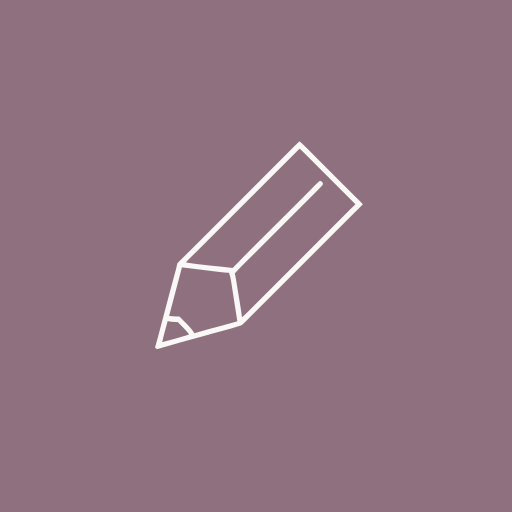
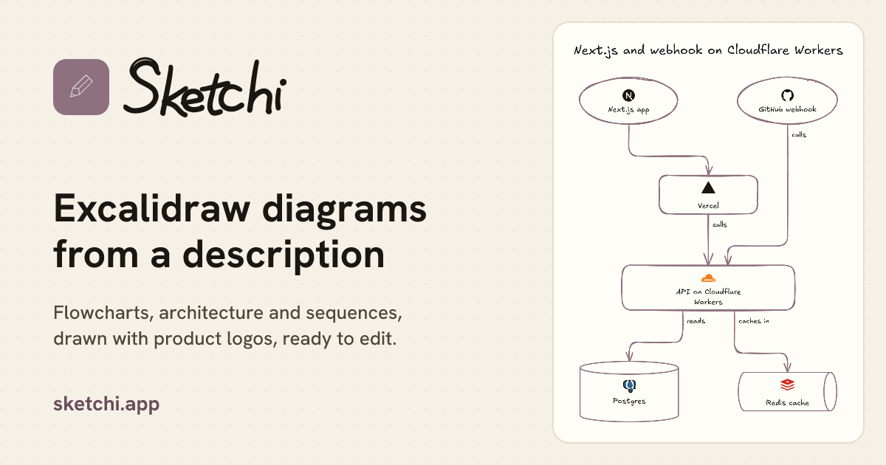

<p align="center">
  
</p>

<h1 align="center">Sketchi</h1>

<p align="center">
  <strong>Excalidraw diagrams from a description.</strong><br />
  Describe a system or a process in a sentence. Sketchi draws it with each product's logo, and every part stays editable.
</p>

<p align="center">
  <a href="https://sketchi.app/"></a>
  <a href="https://www.npmjs.com/package/sketchi"></a>
  <a href="https://nx.dev/"></a>
  <a href="https://workers.cloudflare.com/"></a>
  <a href="https://www.typescriptlang.org/"></a>
  <a href="https://excalidraw.com/"></a>
  <a href="LICENSE"></a>
</p>

---

<p align="center">
  
</p>

Sketchi works from a sentence, or from a typed spec that an agent or the CLI
writes. A model's answer is never the drawing: it is parsed into a typed
diagram, validated, laid out by code, converted to real Excalidraw elements,
and stored with a PNG. It draws flowcharts (with groups, swimlanes and
architecture zones), mindmaps, sequence diagrams, timelines, bar, line and pie
charts, state machines, Gantt charts, ER diagrams, UML class diagrams, org
charts, Venn diagrams, user journey maps, Sankey diagrams, UI wireframes and
quadrant charts.

## Use it

**CLI.** Install the [`sketchi`](https://www.npmjs.com/package/sketchi) command
and turn a description into a PNG you can revise later. Generation needs no
account or API key; authoring, editing and export work offline.

```sh
curl -fsSL https://sketchi.app/install.sh | sh   # or: npm install -g sketchi
sketchi generate --prompt "Deploy with GitHub Actions, Docker and Cloudflare Workers"
```

The [CLI guide](apps/cli/README.md) covers every command, and the
[changelog](apps/cli/CHANGELOG.md) what changed.

**Agents.** Codex, Claude Code, Antigravity and OpenCode draw through the public
MCP server at `https://playground.sketchi.app/mcp`, with no login or local
browser. The [agent quickstart](docs/code-mode-agent-plugins.md) installs the
plugin or skill for each, and the [Code Mode API](docs/mcp-tool-catalog.md) page
describes the server.

**Browser.** [playground.sketchi.app](https://playground.sketchi.app) drafts and
edits diagrams in chat, and [icons.sketchi.app](https://icons.sketchi.app) is the
icon library diagrams draw their logos from.

## How it works

```text
prompt ─▶ model candidate ─▶ typed diagram ─▶ deterministic layout ─▶ Excalidraw scene ─▶ stored artifact + PNG
                                  ▲
                       spec from the CLI or MCP
```

| Package                       | Owns                                                                    |
| ----------------------------- | ----------------------------------------------------------------------- |
| `packages/diagram/core`       | diagram contracts (Effect Schema), semantic validation, shared rules    |
| `packages/diagram/generation` | model prompts, gateway calls, candidate parsing and repair              |
| `packages/diagram/agent`      | the Code Mode build: normalize, validate, render, export, store         |
| `packages/diagram/renderer`   | deterministic layout and routing for every family                       |
| `packages/diagram/excalidraw` | Excalidraw conversion and real-scene validation                         |
| `packages/diagram/scenarios`  | maintained scenarios and the scenario CLI                               |
| `packages/diagram/ui`         | shared React canvas and preview components, and the diagram Storybook   |
| `packages/icons/*`            | the icon catalog and search, community icons, and hand-drawn logos      |
| `packages/svg-excalidraw`     | SVG to native Excalidraw elements and libraries                         |
| `packages/studio/projects`    | Studio project and diagram persistence                                  |
| `packages/observability`      | span telemetry for every Worker request                                 |
| `packages/ui`                 | shadcn primitives and tokens for the Tailwind apps                      |

| App          | Serves                                                                 |
| ------------ | ---------------------------------------------------------------------- |
| `cli`        | the `sketchi` command                                                  |
| `playground` | playground.sketchi.app: Studio, the HTTP API and the MCP server       |
| `web`        | sketchi.app: home, docs and agent setup                                |
| `icons`      | icons.sketchi.app                                                      |
| `excalidraw` | an internal Excalidraw workspace for checking real scenes              |

Every app except the CLI is a Cloudflare Worker. See the
[architecture guide](docs/architecture.md) and, for each family,
[adding a diagram family](docs/diagram-families.md).

## Development

[mise](https://mise.jdx.dev/) pins Node and pnpm:

```sh
mise trust && mise install
pnpm install
pnpm dev                    # every app, through Portless
pnpm nx dev playground      # one app
```

`pnpm ci:local` is the gate: lint and format, typecheck (TypeScript 6 and the
native TypeScript 7 compiler), build and test for every project the change
affects, plus the tooling, deploy and Storybook checks. Remote CI on a pull
request is one Nx-affected typecheck. [AGENTS.md](AGENTS.md#proof) lists the
fuzz suites and other checks to run locally when their inputs change.

A CLI change that should ship gets a changeset (`pnpm changeset`); merging the
Version Packages pull request publishes it.

Graded evals run outside this repository against the scenarios in
`packages/diagram/scenarios`. `pnpm sanity` runs three end-to-end checks
against production or a preview.

## Deployment

Merging to `main` deploys the Worker apps a change affects. A pull request gets
preview Workers when it carries the `preview` label; see
[preview deployments](docs/preview-deploys.md) and the
[production domain runbook](docs/production-domain-cutover.md).

## License

MIT. See [LICENSE](LICENSE).
