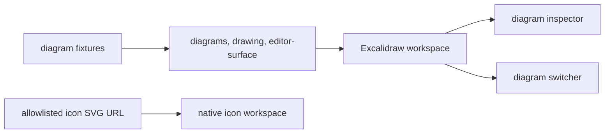

# editor

Internal Excalidraw workspace for inspecting Sketchi diagram artifacts. It
deploys as `sketchi-excalidraw` and uses the shared `@sketchi/editor-surface`
package.



| Owns                              | Does not own                   |
| --------------------------------- | ------------------------------ |
| internal Excalidraw workspace     | generation or model calls      |
| diagram workspace UI              | shared conversion internals    |
| app-local inspector and switcher  | Studio Code Mode API routes    |
| Worker deployment for the surface | authentication or account data |
| allowlisted icon URL import       | hosted scene payloads          |

## Commands

```sh
pnpm nx dev editor          # https://editor.sketchi.localhost
pnpm nx test editor
pnpm nx typecheck editor
pnpm nx build editor
pnpm nx storybook editor
pnpm nx build-storybook editor
```

## Usage

Use this app when validating the actual Excalidraw experience independently of
Studio chat or Code Mode. It composes shared diagram packages and app-local
workspace UI so artifact rendering problems can be isolated from generation.
Do not link it from the public homepage as a standalone product surface. Product
review and edit entry points belong under an owning product flow. The Icons app
may hand off a public corpus SVG through the root route's validated `svg` search
parameter; arbitrary hosts and non-SVG output paths are rejected before fetch.
