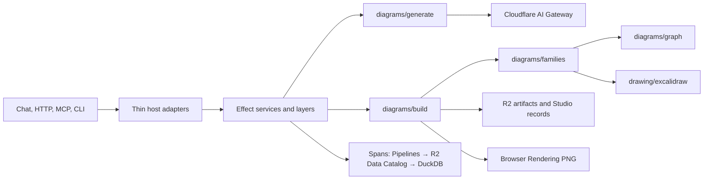

# Sketchi architecture

Sketchi is one Nx workspace deployed on Cloudflare Workers. Effect v4 is the
authoritative programming model for non-trivial I/O, concurrency, time,
resources, expected failures, and observability. Deterministic algorithms and
UI rendering remain ordinary TypeScript and React.

## Runtime map

The four Worker projects are `web`, `studio`, `editor`, and `icons`. `studio`
deploys as `sketchi-studio` and owns chat, the HTTP build and artifact APIs, MCP,
Browser Rendering, and Studio persistence. The internal `editor` app deploys as
`sketchi-excalidraw`; the reusable drawing surface in `packages/editor-surface` is the
separate `editor-surface` project. The Worker map in `tools/ops/src/workers.ts`
resolves project IDs to deployed identities; `tools/ops/src/deploy/` owns
Preview and production route policy. Operator commands (`pnpm ops`, `pnpm ci:local`,
`pnpm db`, `pnpm sanity`) are typed Effect in `tools/ops`.

## Package ownership

| Area                | Authority                                | Responsibility                                                                   |
| ------------------- | ---------------------------------------- | -------------------------------------------------------------------------------- |
| Diagram contracts   | `packages/diagrams/src/families` | Effect Schema IR plus pure semantic validation                                   |
| Layout              | `packages/diagrams/src/families` and `graph` | deterministic scene construction                                                 |
| Excalidraw          | `packages/drawing`            | deterministic conversion and real-scene validation                               |
| Model generation    | `packages/diagrams/src/generate`            | typed provider service, retry, timeout, decode, and candidate summaries          |
| Product build       | `packages/diagrams/src/build`                 | canonical normalize, validate, quality, render, export, and artifact transaction |
| Scenario evaluation | `tools/scenarios`                        | maintained scenarios, pure grading, and internal Effect tooling                  |
| Icon catalog        | `packages/icons/catalog`                 | icon manifest, ranked search, SVG sources, and node-logo eligibility             |
| Icon drawing        | `packages/icons/draw`                    | a logo in, a judged hand-drawn recipe out: author rounds, renders, and the judge |
| Studio persistence  | `apps/studio/src/features/projects`      | typed ownership and scoped R2 persistence services                               |
| Telemetry           | `packages/observability`                 | span rows with full content, batched per request to a Pipelines stream           |
| UI                  | `packages/editor-surface` and app components | React rendering and local view state                                             |
| UI primitives       | `packages/ui`                            | shared shadcn primitives and tokens for the Tailwind apps                        |

Studio chat, HTTP `buildFlowchart`, and MCP `execute` call the same
`diagrams/build` operation. An accepted build writes artifacts once; adapters do
not maintain a second schema, evaluator, runtime, or persistence path.

## Effect composition

Effectful package APIs return `Effect` with typed errors and service
requirements. Services are supplied by `Layer` values at the Worker, Node CLI,
internal tool, or test boundary. Expected failures use schema-backed tagged
errors; interruption and defects remain distinct. Foreign Promise APIs are
wrapped once and receive an `AbortSignal` when supported.

Effect is permitted throughout domain, renderer, React and tooling packages.
Application state and workflows adopt Effect atoms and services; React renders and
TanStack provides the navigation/SSR/build shell. The accepted migration plan assigns
existing implementations to focused proof units; this policy does not claim those
conversions have already shipped.

Runtime entry belongs at Worker, Node, browser or test lifecycle boundaries. Node
entrypoints use `NodeRuntime.runMain`. Foreign callbacks stay in a narrow adapter with
a demonstrated capability gap. Upstream diagnostics catch nested runtime misuse but
do not prove ownership of every outer runtime invocation; review and behavioral
resource/cancellation tests establish that boundary. API maturity is not a ban.

See [Effect conventions](effect-conventions.md) and
[ADR 0004](adr/0004-effect-v4-cloudflare-architecture.md).

## Generation and gateway routing

Worker generation uses the Cloudflare AI Gateway binding with `collectLog` and
bounded request metadata. The binding runs server-side and supplies its stored
BYOK provider key. The public `POST /api/v1/generate` endpoint on the Studio
Worker exposes this vertical unauthenticated, with the same typed error contract
and usage telemetry as the sibling `/api/v1` build endpoints. The public CLI's
commands are registered in [`apps/cli/src/cli.ts`](../apps/cli/src/cli.ts);
`sketchi --help` lists them.

`POST /api/v1/icons/draw` on the same Worker draws a logo by hand: an SVG or a
PNG, JPEG or WebP and a name in, a checked recipe, PNG previews, an
`.excalidrawlib` and a judge's verdict out. A Claude author drafts and revises
against renders of its own recipe on the gateway's native Messages route; an
OpenAI judge picks the source among catalog look-alikes from the 28 px drawing.
Browser Rendering's export harness decodes logos and exports the renders. Each
client IP may send 6 draw requests a minute (the `ClientRateLimit` Durable
Object, one per IP, counting each request exactly), and
every client together `SKETCHI_ICON_DAILY_DRAWS` a UTC day (the `IconDrawBudget`
Durable Object), which bounds model spend; over either limit the endpoint
answers 429 with `Retry-After`. Code Mode scripts call the same draw as
`sketchi.drawIcon({ name, svg })`, which returns the recipe and verdict without
the images. See [icon-draw](../packages/icons/draw/README.md).

Scenario and harness commands are internal Nx/tool entrypoints and are not
public CLI commands.

## Persistence and telemetry

R2 stores accepted artifacts and Studio project records. Browser Rendering
produces PNG artifacts within a scoped lifecycle.

Every finished Effect span inside a request is sent, with its full content, as a
row in an Iceberg table. `packages/observability` supplies the tracer and logger. A
request's root span (`playground.request`, `studio.mcp`, `icons.http`,
`icons.mcp`, or a PNG renderer call) owns every span beneath it, including work
the request leaves running, such as a streamed response or a callback. The host
closes the request's scope under `waitUntil` once that work ends; closing it
sends the request's spans together to the `TELEMETRY_SPANS` Pipeline stream and
waits for the send. A span outside every request, a failed send or a lost isolate
leaves no row. A row holds the trace, span and parent
IDs, name, kind, service, start, end and duration, the outcome with the typed
error, its message and the full cause, every attribute as JSON, and the span's
events: its Effect logs, metric updates and span events. Every row of a request
carries its Cloudflare ray ID and its run and attempt IDs, taken from
`x-sketchi-run-id` and `x-sketchi-attempt-id` or created when the request starts;
a span that records its own run keeps it. The Workers clock only advances
on I/O, so many spans share a start time; `sketchi.span.start_seq` counts span
starts within an isolate and orders them. A log with no open span becomes a row
of its own. Warn and Error logs also go to the console.

Content is recorded in full, under these attribute names:

- Each model call's `diagramGeneration.gatewayChat.attempt` span uses OpenTelemetry GenAI
  names: `gen_ai.system_instructions`, `gen_ai.input.messages`,
  `gen_ai.output.messages` with the finish reason, `gen_ai.usage.*`, and
  `gen_ai.request.*`. It also records the gateway's raw response as
  `http.response.body`.
- Repairs (`diagramGeneration.repair`, `diagramGeneration.coverage.repair`),
  coverage checks (`diagramGeneration.coverage.check`), model calls
  (`diagramGeneration.executeModelCall`) and the whole generation
  (`diagramGeneration.runWithPolicy`) record `sketchi.input` and `sketchi.output`.
  Retries are sibling attempt spans with an `attempt` number.
- Every Code Mode operation (`codeMode.<operation>`) records its input and output
  the same way.
- Each Code Mode call (an API build, patch, canvas or generate, or an MCP
  `execute`) has a `playground.codeModeUsage.capture` span. It records the usage
  summary as `sketchi.usage.event`, every issue the call reported as
  `sketchi.usage.issues`, and the full request and response as `sketchi.input`
  and `sketchi.output`. The `usage_events` and `usage_issues` views read them.
- `playground.request` records the URL, the request and response headers, the
  status and the response body. Cookie and authorization headers are left out
  because they are credentials. The span that reads a body records it as
  `http.request.body`: `playground.http.readJsonBody` (diagrams API) or
  `playground.http.readBoundedJson` (chat and icon draw) within its byte limit.
  Project handlers record their decoded payload on the current span. An event-stream
  response passes through unchanged, keeping its backpressure and cancellation.
  `playground.response.stream` records it once it ends, and marks a stream the
  client left with `http.response.body.complete: false`.
- PNG renderer calls continue the caller's trace across the Durable Object call.

A stream record cannot exceed 1 MB and a send cannot exceed 5 MB. A span larger
than about 900 KB continues across rows that share its IDs, numbered by
`part_index` with `part_count` rows. Nothing is truncated, and the `spans` view
joins the rows back together.

| Resource                    | Production                                      | Preview                                      |
| --------------------------- | ----------------------------------------------- | -------------------------------------------- |
| Bucket with R2 Data Catalog | `sketchi-telemetry-production`                  | `sketchi-telemetry-preview`                  |
| Table                       | `observability.spans`                           | `observability.spans`                        |
| Stream                      | `sketchi_telemetry_spans_production`            | `sketchi_telemetry_spans_preview`            |
| Sink                        | `sketchi_telemetry_spans_production_catalog`    | `sketchi_telemetry_spans_preview_catalog`    |
| Pipeline                    | `sketchi_telemetry_spans_production_to_catalog` | `sketchi_telemetry_spans_preview_to_catalog` |

The stream schema is `packages/observability/spans.schema.json`.
`pnpm telemetry:resources` prints the map, and `pnpm telemetry:provision`, run
with a catalog admin token in `WRANGLER_R2_SQL_AUTH_TOKEN`, creates whatever is
missing. Sinks roll a file every 60 seconds, which is Pipelines' minimum, so a
row is queryable about a minute after its request ends. Both catalogs compact
to 128 MB files and expire snapshots older than 7 days, keeping at least 5.
Pipelines ingestion is free. Delivery to Iceberg costs $0.06/GB after 50 GB a
month, and R2 storage is billed as usual.

`pnpm db` opens the DuckDB release pinned in `mise.toml` with
`tools/ops/src/telemetry/duckdb-init.sql` and the views in `duckdb-views.sql`. It attaches the
spans catalog using `CLOUDFLARE_ACCOUNT_ID` and a read-only `R2_DATA_READ_TOKEN`.
If the token is unset, export `INFISICAL_PROJECT_ID` to load the project's `prod`
environment. The account ID must be exported locally or supplied by Infisical. `pnpm db --preview` reads the preview
spans catalog, and DuckDB arguments pass
through, for example `pnpm db -c "FROM generations LIMIT 5"`. It defines these
views:

- `spans`: one row per span, with `attributes`, `events` and `error` as JSON. A
  split span appears once all its parts have arrived.
- `incomplete_spans`: split spans still missing a part, such as a late batch
- `span_tree('<trace_id>')`: one trace, indented by parent
- `generations`: one row per generation, with its prompt, output, tokens, model
  calls, repairs, coverage issues and durations
- `slowest_spans` and `span_durations`: the last seven days
- `usage_events` and `usage_issues`: one row per Code Mode call and per issue it
  reported, with the call's request and response

Code Mode usage rows written before usage moved into spans stay in the
`sketchi-codemode-usage-analytics-{production,preview}-v4` catalogs, and the raw
`codemode/usage/**/event.json` objects stay in the artifacts buckets. `pnpm db`
attaches the production catalog read-only as `codemode_history`, with
`codemode_history.sketchi_codemode.usage_events` and `.usage_issues`.

No module starts I/O or timers at import time. Worker bindings are translated
to layers per host lifecycle, and response-adjacent best-effort work is handed
to the Cloudflare execution context where required.

## Workspace enforcement and proof

Nx and type-aware Oxlint enforce dependency direction, including imports from
configuration and Storybook files. Existing schema, Promise misuse and React
synchronization restrictions remain. Effect diagnostics and their exceptions are
described in the Diagnostics section of [Effect conventions](effect-conventions.md).
The local gate and the checks each change needs are in
[AGENTS.md](../AGENTS.md#proof).

## Deployment map

- `sketchi.app` and `www.sketchi.app` → `web`
- `playground.sketchi.app` → `studio` / `sketchi-studio`
- `icons.sketchi.app` → `icons`
- `editor` → `sketchi-excalidraw`, workers.dev only, no custom domain

Previews use a stable `pr-<number>` name on each existing Worker. Production or preview claims require exact-head runtime evidence; a
successful build alone is not deployment proof.
