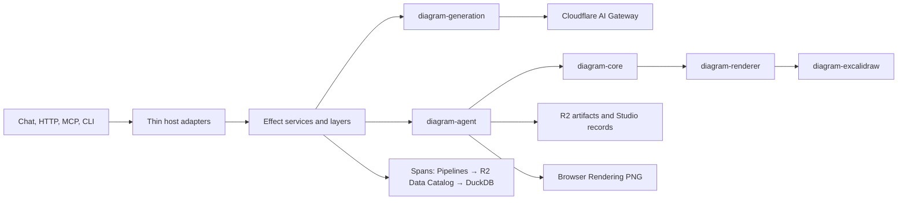

# Sketchi architecture

Sketchi is one Nx workspace deployed on Cloudflare Workers. Effect v4 is the
authoritative programming model for non-trivial I/O, concurrency, time,
resources, expected failures, and observability. Deterministic algorithms and
UI rendering remain ordinary TypeScript and React.

## Runtime map

The five Worker projects are `web`, `playground`, `eval-harness`, `excalidraw`,
and `icons`. `playground` deploys as the durable `sketchi-studio` Worker and
owns chat, HTTP build/artifact APIs, MCP, Browser Rendering, and Studio
persistence. `eval-harness` deploys as `sketchi-playground` and remains an
internal scenario surface. Preview identities and production routes come only
from `scripts/lib/worker-apps.mjs`.

## Package ownership

| Area                | Authority                                | Responsibility                                                                   |
| ------------------- | ---------------------------------------- | -------------------------------------------------------------------------------- |
| Diagram contracts   | `packages/diagram/core`                  | Effect Schema IR plus pure semantic validation                                   |
| Layout              | `packages/diagram/renderer`              | deterministic scene construction                                                 |
| Excalidraw          | `packages/diagram/excalidraw`            | deterministic conversion and real-scene validation                               |
| Model generation    | `packages/diagram/generation`            | typed provider service, retry, timeout, decode, and candidate summaries          |
| Product build       | `packages/diagram/agent`                 | canonical normalize, validate, quality, render, export, and artifact transaction |
| Scenario evaluation | `packages/diagram/scenarios`             | maintained scenarios, pure grading, and internal Effect tooling                  |
| Icon catalog        | `packages/icons/catalog`                 | icon manifest, ranked search, SVG sources, and node-logo eligibility             |
| Studio persistence  | `packages/studio/projects`               | typed ownership and scoped R2 persistence services                               |
| Telemetry           | `packages/observability`                 | span rows with full content, batched per request to a Pipelines stream           |
| UI                  | `packages/diagram/ui` and app components | React rendering and local view state                                             |
| UI primitives       | `packages/ui`                            | shared shadcn primitives and tokens for the Tailwind apps                        |

Studio chat, HTTP `buildFlowchart`, and MCP `execute` call the same
`diagram-agent` operation. An accepted build writes artifacts once; adapters do
not maintain a second schema, evaluator, runtime, or persistence path.

## Effect composition

Effectful package APIs return `Effect` with typed errors and service
requirements. Services are supplied by `Layer` values at the Worker, Node CLI,
internal tool, or test boundary. Expected failures use schema-backed tagged
errors; interruption and defects remain distinct. Foreign Promise APIs are
wrapped once and receive an `AbortSignal` when supported.

The approved runtime edges are mechanically checked:

- the Node CLI entrypoint;
- the eval-harness server-function adapter;
- the Playground Worker runtime composition root;
- the two internal scenario tool entrypoints;
- the internal harness-eval entrypoint.

The CLI imports the stable `effect/cli` surface through the package-internal
`apps/cli/src/internal/effect-cli.ts` adapter. The repository has no unstable
Effect imports. Process management uses stable core Effect APIs plus a scoped
Node adapter.

See [Effect conventions](effect-conventions.md), the
[program-closure inventory](effect-program-closure-inventory.md), and
[ADR 0004](adr/0004-effect-v4-cloudflare-architecture.md).

## Generation and gateway routing

Worker generation uses the Cloudflare AI Gateway binding with `collectLog` and
bounded request metadata. The binding runs server-side and supplies its stored
BYOK provider key. The public `POST /api/v1/generate` endpoint on the Playground
Worker exposes this vertical unauthenticated, with the same typed error contract
and usage telemetry as the sibling `/api/v1` build endpoints. The public CLI has
nine commands. `create`, `show`, `edit`, `list`, `restore`, and `export` remain
offline. The credential-free network commands are `generate`, `share`, and
`pull`: each makes one unauthenticated HTTPS request to its documented endpoint
and needs no token, key, account, or login. `share` uses randomized client-side
encryption, and `pull` depends on Excalidraw share availability.

Scenario and harness commands are internal Nx/tool entrypoints and are not
public CLI commands.

## Persistence and telemetry

R2 stores accepted artifacts, Code Mode usage snapshots, and Studio project
records. Browser Rendering produces PNG artifacts within a scoped lifecycle.
Pipelines receive flat usage and issue rows; the existing R2 Data Catalog and
R2 SQL verifier provide aggregate proof.

Every finished Effect span is stored, with its full content, as a row in an
Iceberg table. `packages/observability` supplies the tracer and logger. A
request's root span (`playground.request`, `evalHarness.request`, or a PNG
renderer call) adopts a batch, and every span beneath it joins that batch.
The batch is sent to the `TELEMETRY_SPANS` Pipeline stream through `waitUntil`
when the root ends. Spans the request left running, such as a streamed response,
are sent in a later batch once they end. A row holds the trace, span and parent
IDs, name, kind, service, start, end and duration, the outcome with the typed
error, its message and the full cause, every attribute as JSON, and the span's
events: its Effect logs, metric updates and span events. Rows also carry the
Cloudflare ray ID and the run and attempt IDs. The Workers clock only advances
on I/O, so many spans share a start time; `sketchi.span.start_seq` counts span
starts within an isolate and orders them. A log with no open span becomes a row
of its own. Warn and Error logs also go to the console.

Content is recorded in full, under these attribute names:

- Each model call's `diagramGeneration.gatewayChat.attempt` span uses OpenTelemetry GenAI
  names: `gen_ai.system_instructions`, `gen_ai.input.messages`,
  `gen_ai.output.messages` with the finish reason, `gen_ai.usage.*`, and
  `gen_ai.request.*`. It also records the gateway's raw response as
  `http.response.body`.
- Repairs (`diagramGeneration.repair`, `diagramGeneration.coverage.repair`),
  coverage checks (`diagramGeneration.coverage.check`), model calls
  (`diagramGeneration.executeModelCall`) and the whole generation
  (`diagramGeneration.runWithPolicy`) record `sketchi.input` and `sketchi.output`.
  Retries are sibling attempt spans with an `attempt` number.
- Every Code Mode operation (`playground.codeMode.*`) records its input and output
  the same way.
- `playground.request` records the URL, the request and response headers, the
  status and the response body. Cookie and authorization headers are left out
  because they are credentials. The span that reads a body records it as
  `http.request.body`: `playground.http.readBoundedJson` within its byte limit,
  `playground.http.mcp`, and `studioPersistence.http.readJson`. An event-stream
  response passes through unchanged, keeping its backpressure and cancellation.
  `playground.response.stream` records it once it ends, and marks a stream the
  client left with `http.response.body.complete: false`.
- PNG renderer calls continue the caller's trace across the Durable Object call.

A stream record cannot exceed 1 MB and a send cannot exceed 5 MB. A span larger
than about 900 KB continues across rows that share its IDs, numbered by
`part_index` with `part_count` rows. Nothing is truncated, and the `spans` view
joins the rows back together.

| Resource                    | Production                                      | Preview                                      |
| --------------------------- | ----------------------------------------------- | -------------------------------------------- |
| Bucket with R2 Data Catalog | `sketchi-telemetry-production`                  | `sketchi-telemetry-preview`                  |
| Table                       | `observability.spans`                           | `observability.spans`                        |
| Stream                      | `sketchi_telemetry_spans_production`            | `sketchi_telemetry_spans_preview`            |
| Sink                        | `sketchi_telemetry_spans_production_catalog`    | `sketchi_telemetry_spans_preview_catalog`    |
| Pipeline                    | `sketchi_telemetry_spans_production_to_catalog` | `sketchi_telemetry_spans_preview_to_catalog` |

The stream schema is `packages/observability/spans.schema.json`.
`pnpm telemetry:resources` prints the map, and `pnpm telemetry:provision`, run
with a catalog admin token in `WRANGLER_R2_SQL_AUTH_TOKEN`, creates whatever is
missing. Sinks roll a file every 60 seconds, which is Pipelines' minimum, so a
row is queryable about a minute after its request ends. Both catalogs compact
to 128 MB files and expire snapshots older than 7 days, keeping at least 5.
Pipelines ingestion is free. Delivery to Iceberg costs $0.06/GB after 50 GB a
month, and R2 storage is billed as usual.

`pnpm db` opens DuckDB with `scripts/telemetry/duckdb-init.sql`. It attaches the
spans catalog and the Code Mode usage catalog with a read-only
`R2_DATA_READ_TOKEN`, which it takes from Infisical when the variable is unset.
`pnpm db --preview` reads the preview catalogs, and DuckDB arguments pass
through, for example `pnpm db -c "FROM generations LIMIT 5"`. It defines these
views:

- `spans`: one row per span, with `attributes`, `events` and `error` as JSON
- `span_tree('<trace_id>')`: one trace, indented by parent
- `generations`: one row per generation, with its prompt, output, tokens, model
  calls, repairs, coverage issues and durations
- `slowest_spans` and `span_durations`: the last seven days
- `usage_events` and `usage_issues`: the Code Mode usage tables

No module starts I/O or timers at import time. Worker bindings are translated
to layers per host lifecycle, and response-adjacent best-effort work is handed
to the Cloudflare execution context where required.

## Workspace enforcement and proof

pnpm, Nx, TypeScript project references, and the Oxlint Nx boundary rule agree
on one explicit project inventory. Type-aware Oxlint enforces package rings,
Effect-free pure and framework-native projects, reviewed unstable Effect
adapters, no Zod, and no direct React effects outside reasoned synchronization
adapters. Structural tests keep that lint configuration in sync with the project
classification, prove each rule rejects a real violation, and enforce exact
Effect pins, runtime-boundary ownership, and no unmanaged Promise orchestration
outside reviewed framework/foreign edges. Wrangler dry-runs cover every mapped
Worker.

Meaningful changes run the full Nx typecheck/test/build graph, repository-wide
type-aware Oxlint, the composite TypeScript build, Storybook,
tool/deploy/onboarding tests, corpus rendering, Worker dry-runs, bundle reports,
packaged CLI smoke, and applicable preview runtime probes.

## Deployment map

- `sketchi.app` and `www.sketchi.app` → `web`
- `playground.sketchi.app` → `playground` / `sketchi-studio`
- `icons.sketchi.app` → `icons`
- eval-harness and Excalidraw workspaces → internal Workers

Preview deploys remove production routes and use the canonical per-PR Worker
names. Production or preview claims require exact-head runtime evidence; a
successful build alone is not deployment proof.
