# Sketchi Code Mode API Contract

This is the implementation spec for the first Sketchi agent-facing API surface.
It replaces the earlier "MCP tool catalog" framing with a narrower boundary:
Sketchi exposes a small MCP server for external agent harnesses, and the Code
Mode sandbox calls curated host APIs. The host APIs are normal Worker APIs backed
by the shared diagram packages.

The goal is not to make every internal function callable. The goal is to let
Claude Code, Codex, OpenCode, and similar harnesses build a correct semantic
diagram or arbitrary typed canvas artifact through one clear contract, get
structured repair feedback when they are wrong, and retrieve the result.

## Implementation Plan

Completed behavior is tracked by the code. The remaining next-PR work is tracked
in [Code Mode Next PR Plan](codemode-next-pr-plan.md).

## Decisions

- Use Code Mode for agent orchestration.
- Do not model the diagram runtime as a set of granular MCP tools.
- Do not expose `validate`, `grade`, `render`, or `export` as public operations.
- Use normal host APIs as the source of truth for request and response shapes.
- Register curated Code Mode functions over those host APIs.
- Use the family-specific semantic builders when they fit; use one typed
  `createCanvas` host function for arbitrary visualizations.
- Define `applyDiagramPatch` up front as the first deterministic mutation
  operation for styling, shape, text, and layout changes.
- Agents must get the semantic flow and connectivity accepted before applying
  styling or shape codemods.
- Keep `draft` and managed threads out of this slice.
- Studio chat, HTTP API, and MCP all call the same canonical `buildFlowchart`
  runtime. Studio injects its artifact formats and limits one model turn to
  three attempts; an accepted call is already the persisted canvas artifact.
- Keep Effect, storage, auth, rendering, and model credentials host-side.

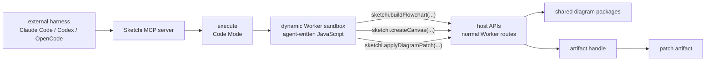

## Boundary

Sketchi has three layers. Only the top layer is MCP. The middle layer is Code
Mode. The bottom layer is the product API/runtime.

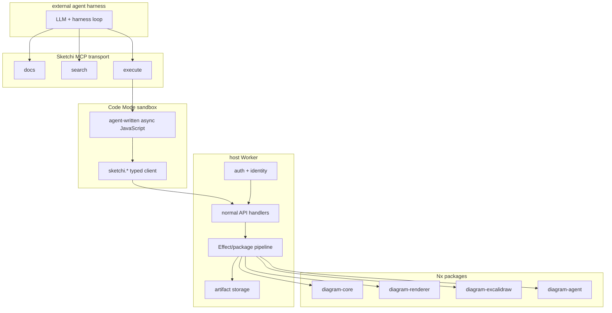

The sandbox is not trusted with secrets, tokens, storage bindings, model
credentials, or direct network access. It receives typed functions only.

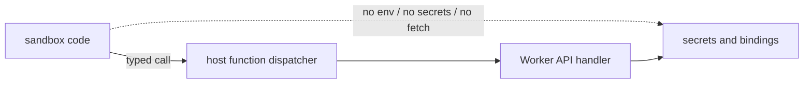

## Public MCP Surface

The external MCP server should stay small. The names below are MCP tools from
the harness point of view, not diagram runtime functions.

| MCP tool  | Purpose                                                           | Calls diagram runtime? |
| --------- | ----------------------------------------------------------------- | ---------------------- |
| `docs`    | Return the curated API contract, examples, and current non-goals. | No                     |
| `search`  | Search operation docs, issue codes, examples, and schema notes.   | No                     |
| `execute` | Run Code Mode JavaScript with the `sketchi.*` client injected.    | Yes                    |

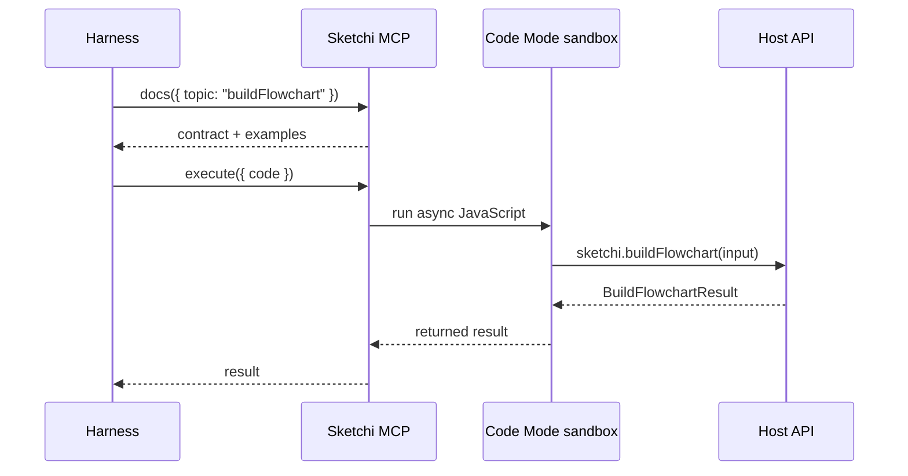

### `docs`

```ts
interface DocsRequest {
  topic?:
    | "overview"
    | "execute"
    | "buildFlowchart"
    | "buildMindmap"
    | "buildSequenceDiagram"
    | "createCanvas"
    | "getArtifact"
    | "applyDiagramPatch"
    | "patchOperations"
    | "agentSequence"
    | "issues"
    | "examples";
}

interface DocsResult {
  topic: string;
  content: string;
  examples: CodeExample[];
  version: string;
}

interface CodeExample {
  title: string;
  language: "ts" | "js" | "json";
  code: string;
}
```

### `search`

```ts
interface SearchRequest {
  query: string;
  limit?: number;
}

interface SearchResult {
  query: string;
  results: SearchHit[];
}

interface SearchHit {
  id: string;
  kind: "operation" | "schema" | "issue" | "example" | "non_goal";
  title: string;
  snippet: string;
  score: number;
}
```

### `execute`

The `execute` tool runs an async JavaScript arrow function in Code Mode. The
tool description must include the current `sketchi.*` TypeScript declarations
and one flowchart repair-loop example.

```ts
interface ExecuteRequest {
  code: string;
}

type ExecuteResult =
  | {
      ok: true;
      result: unknown;
      logs: string[];
    }
  | {
      ok: false;
      error: string;
      logs: string[];
    };
```

Inside `execute`, the sandbox receives this namespace:

```ts
declare const sketchi: {
  buildFlowchart(input: BuildFlowchartRequest): Promise<BuildFlowchartResult>;
  buildMindmap(input: BuildMindmapRequest): Promise<BuildMindmapResult>;
  buildSequenceDiagram(
    input: BuildSequenceDiagramRequest,
  ): Promise<BuildSequenceDiagramResult>;
  createCanvas(input: CreateCanvasRequest): Promise<CreateCanvasResult>;
  getArtifact(input: GetArtifactRequest): Promise<GetArtifactResult>;
  applyDiagramPatch(
    input: ApplyDiagramPatchRequest,
  ): Promise<ApplyDiagramPatchResult>;
};
```

The sandbox must not receive low-level API keys, tokens, bindings, or raw
storage handles.

## Host API Surface

These are normal host API operations. Code Mode functions call them through the
host dispatcher. A future HTTP adapter can expose the same contracts directly.

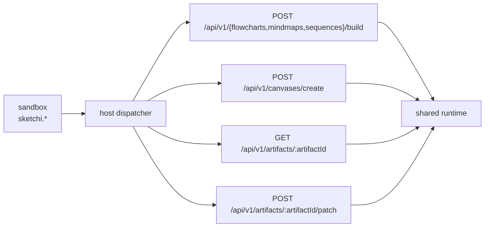

| Host operation                             | Code Mode function                    | Public now?           |
| ------------------------------------------ | ------------------------------------- | --------------------- |
| `POST /api/v1/flowcharts/build`            | `sketchi.buildFlowchart(input)`       | Yes                   |
| `POST /api/v1/mindmaps/build`              | `sketchi.buildMindmap(input)`         | Yes                   |
| `POST /api/v1/sequences/build`             | `sketchi.buildSequenceDiagram(input)` | Yes                   |
| `POST /api/v1/canvases/create`             | `sketchi.createCanvas(input)`         | Yes                   |
| `GET /api/v1/artifacts/:artifactId`        | `sketchi.getArtifact(input)`          | Yes                   |
| `POST /api/v1/artifacts/:artifactId/patch` | `sketchi.applyDiagramPatch(input)`    | Yes                   |
| validate IR                                | none                                  | No, internal to build |
| grade quality                              | none                                  | No, internal to build |
| render scene                               | none                                  | No, internal to build |
| export Excalidraw                          | none                                  | No, internal to build |
| draft from prompt                          | none                                  | No, later             |
| managed thread                             | none                                  | No, later             |

## Agent Sequencing

Agents should handle user requests in two phases:

1. Build and repair the semantic graph.
2. Patch visual styling, shape, text, or layout details against the accepted
   artifact.

This matters even when the human request mixes structure and style in one
sentence, such as "I want a circle connected to a decision diamond that is
purple." The first call should still produce a valid flowchart with correct
nodes and edges. Only after `buildFlowchart` returns `ok: true` should the agent
use `applyDiagramPatch` to set the circle shape, diamond shape, color, or
positioning.

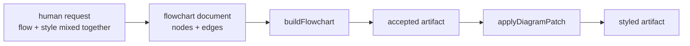

Do not ask the model to directly edit native Excalidraw JSON for common style
or shape changes. Native Excalidraw is intentionally treated as a noisy export
format. Agents should prefer compact Sketchi specs, deterministic scene
artifacts, and structured patch operations.

## `buildFlowchart`

`buildFlowchart` is the first real product operation. It accepts a creation
friendly flowchart spec, validates it, grades it, renders it, exports it to
Excalidraw, stores requested artifacts, and returns either an accepted artifact
or structured repair feedback.

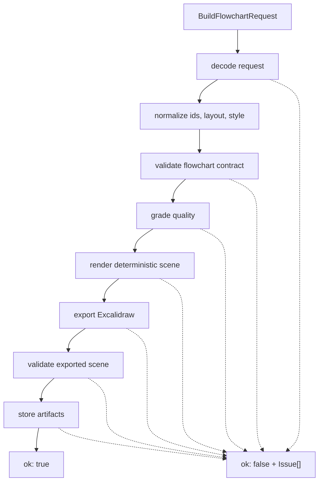

### Request

```ts
interface BuildFlowchartRequest {
  requestId?: string;
  spec: FlowchartDocument;
  options?: BuildFlowchartOptions;
}

interface BuildFlowchartOptions {
  artifactFormats?: ArtifactFormat[];
  inlineArtifacts?: InlineArtifactFormat[];
  minQualityScore?: number;
}

interface BuildMindmapRequest {
  requestId?: string;
  spec: MindmapSpec;
  options?: BuildFlowchartOptions;
}

interface BuildSequenceDiagramRequest {
  requestId?: string;
  spec: SequenceDiagramSpec;
  options?: BuildFlowchartOptions;
}

interface SequenceDiagramSpec {
  id?: string;
  title: string;
  participants: Array<{ id: string; label: string; kind?: string }>;
  messages?: Array<{
    id?: string;
    source: string;
    target: string;
    label: string;
    type?: "message" | "return";
    style?: "solid" | "dashed";
  }>;
  style?: FlowchartStyle;
}

interface MindmapSpec {
  id?: string;
  title: string;
  root: MindmapTopic;
  layout?: { direction?: "LR" | "RL" };
  style?: FlowchartStyle;
}

interface MindmapTopic {
  label: string;
  children?: MindmapTopic[];
}

type ArtifactFormat = "excalidraw" | "scene" | "png";
type InlineArtifactFormat = "excalidraw" | "scene";
```

Defaults:

```json
{
  "artifactFormats": ["excalidraw", "scene"],
  "inlineArtifacts": ["scene"],
  "minQualityScore": 8
}
```

Studio HTTP build endpoints accept request bodies up to 256 KiB. The same bound
is enforced while reading streamed or chunked bodies without `Content-Length`.
An oversized body returns HTTP 413 with `status: "invalid_input"` and a typed
`request_too_large` issue before rendering or artifact persistence.

### Flowchart Spec

`spec` is the flowchart document, the same JSON every surface reads and writes
(MCP, the CLI, Studio and the HTTP API). It is defined once, in
`@sketchi/diagram-core` (`flowchart-document.ts`).

```ts
interface FlowchartDocument {
  id?: string;
  title: string;
  direction?: "TB" | "LR"; // TB by default
  logos?: true | "exact";   // draw the logo each node label names
  nodes: Record<NodeId, string | FlowchartNode>; // id → label, or id → details
  edges: Array<[from: End, to: End, label?: string]>;
  groups?: Record<GroupId, { label: string; kind?: ZoneKind; contains: string[] }>;
  lanes?: Record<LaneId, { label: string; contains: string[] }>;
}

interface FlowchartNode {
  label: string;
  note?: string;                                        // a subtitle under the label
  shape?: "database" | "queue" | "document" | "storage" | "diamond";
  icon?: string | null;                                 // a product name or slug; null draws none
}

type End = NodeId | NodeId[]; // a list draws one edge per id
type ZoneKind = "cloud" | "datacenter" | "region" | "zone" | "vpc" | "subnet" | "cluster" | "namespace";
```

Ids start with a letter and use letters, digits, `_` and `-`, so JavaScript keeps
the written order. An edge's identity is its two ends.

Nobody declares a node's role. A decision (a diamond) is a node whose label asks
a question, or one given `shape: "diamond"`; labeled edges out of any other node
stay plain labeled edges. Any
other node that nothing enters starts the flow and one that nothing leaves ends
it; when a loop returns to the first step, the first node written is the entry.
A flowchart may have several entries.

Containers list what they hold: a group's `contains` names nodes and other groups,
at any depth, and Sketchi derives the tree, so a node listed by both a region and
the VPC inside it sits in the VPC. A group that no other group lists sits inside
the smallest group holding all its nodes. Lanes hold every node, keep their
written order and never mix with groups.

With `logos`, every node whose label names a product draws its logo, written with or
without a dot ("Node.js", "Socket.io"). A name that is also an English word counts as
the label's first word only when it is the whole label or a tech noun follows it
("Python worker", "React app"). Otherwise the label reads as a step ("Make payment",
"Sync the order to the warehouse"): it draws nothing, and an `icon_possible` note
names the product it could mean. A node draws one logo: a label that names several products ("Next.js app hosted on Vercel") draws the
first, and its `icon_filled` note names the others. `true` draws a mark the catalog has a hand-drawn
recipe for as editable Excalidraw shapes in the scene's own pen, and `"exact"` embeds
every mark's catalog SVG. A node's `icon` names a logo its label does not, or another
of the products it names, and `null` drops one. An icon that names no logo is
dropped with `unknown_icon`, and a vendor's logo on a label that does not name the
vendor with `icon_dropped`. Icons never fail the build. Sequence participants and
canvases still take `{ slug }` icons found with `sketchi.searchIcons`. Search also
returns generic concept icons (collection `concepts`: database, queue, user, cloud,
and others), always drawn by hand; a node's `icon` or a `{ slug }` icon attaches
one by its slug when the node is that thing. No label fills in a concept icon.

### Flowchart Checks

A build reports every problem at once, each at its `spec` path with a repair hint
naming the nearest declared ids:

- an edge end names no node (`missing_edge_source`, `missing_edge_target`);
- an edge connects a node to itself (`self_loop`) or repeats a pair (`duplicate_edge`);
- a node has no edges (`isolated_node`);
- a loop has no way out (`nonterminating_node`), or only a loop reaches a node (`unreachable_node`);
- a question with two or more exits leaves one unlabeled (`unlabeled_decision_branch`)
  or repeats a label (`duplicate_decision_branch_label`);
- an id breaks the pattern (`invalid_id`), names both a node and a container, or is
  another id with spaces around it (`duplicate_node_id`, `duplicate_group_id`, `duplicate_lane_id`);
- a container lists an unknown id (`unknown_member`), two containers that do not nest
  share a member (`overlapping_containers`), groups nest in a cycle (`group_cycle`),
  a node has no lane (`node_without_lane`), or lanes are mixed with groups (`lanes_with_groups`);
- fewer than two nodes or no edge (`flowchart_too_small`), or more than 80 nodes, 120
  drawn edges, 8 groups, 8 lanes or 4 levels of nesting (`flowchart_too_large`, with status
  `limit_exceeded`). Edges are counted with each list end expanded, before any is drawn.

Issue output is capped deterministically at 20 entries.

### Result

```ts
type BuildFlowchartResult = BuildFlowchartSuccess | BuildFlowchartFailure;

interface BuildFlowchartSuccess {
  ok: true;
  status: "accepted";
  buildId: string;
  requestId?: string;
  normalizedSpec: FlowchartDocument; // as drawn: id and direction filled, logo slugs resolved
  quality: QualityReport;
  artifact: ArtifactBundle;
  issues: Issue[];
}

interface BuildFlowchartFailure {
  ok: false;
  status:
    | "invalid_input"
    | "invalid_flowchart"
    | "quality_failed"
    | "limit_exceeded"
    | "render_failed"
    | "export_failed"
    | "storage_failed";
  buildId?: string;
  requestId?: string;
  normalizedSpec?: FlowchartDocument;
  quality?: QualityReport;
  partial?: PartialArtifactBundle;
  issues: Issue[];
}

type BuildMindmapResult = BuildMindmapSuccess | BuildMindmapFailure;

interface BuildMindmapSuccess {
  ok: true;
  status: "accepted";
  buildId: string;
  requestId?: string;
  normalizedSpec: unknown;
  quality: QualityReport;
  artifact: ArtifactBundle;
  issues: Issue[];
}

interface BuildMindmapFailure {
  ok: false;
  status:
    | "invalid_input"
    | "invalid_mindmap"
    | "quality_failed"
    | "render_failed"
    | "export_failed"
    | "storage_failed";
  buildId?: string;
  requestId?: string;
  normalizedSpec?: unknown;
  quality?: QualityReport;
  partial?: PartialArtifactBundle;
  issues: Issue[];
}
```

`issues` is empty when the build is accepted and there are no warnings. Warnings
may still be present on accepted builds.

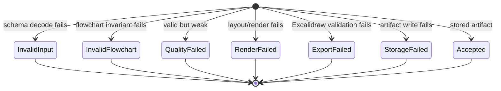

### Quality Report

```ts
interface QualityReport {
  accepted: boolean;
  score: number;
  threshold: number;
  summary: {
    nodeCount: number;
    edgeCount: number;
  };
  checks: QualityCheck[];
}

interface QualityCheck {
  code: string;
  passed: boolean;
  severity: "error" | "warning";
  message: string;
  refs: IssueRef[];
}
```

## Issue Contract

Issues are the main repair interface. They must be stable, machine-readable, and
good enough for an agent to patch its spec without guessing.

```ts
interface Issue {
  code: IssueCode;
  severity: "error" | "warning";
  stage:
    | "input"
    | "flowchart"
    | "mindmap"
    | "quality"
    | "render"
    | "export"
    | "storage";
  ref?: IssueRef;
  message: string;
  hint: string;
}

interface IssueRef {
  kind: "request" | "diagram" | "node" | "edge" | "artifact";
  id?: string;
  path?: string;
}
```

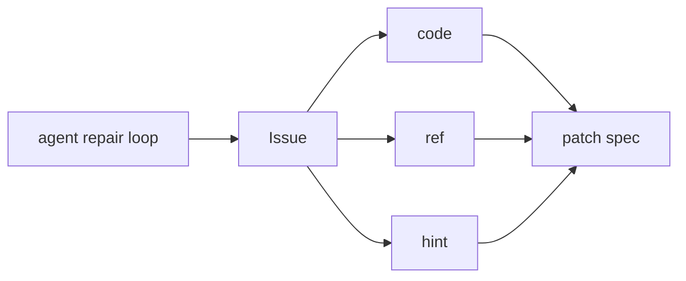

Initial issue codes:

```ts
type IssueCode =
  | "missing_field"
  | "invalid_type"
  | "invalid_enum"
  | "invalid_color"
  | "duplicate_node_id"
  | "duplicate_edge_id"
  | "missing_edge_source"
  | "missing_edge_target"
  | "self_loop"
  | "missing_start"
  | "multiple_starts"
  | "missing_end"
  | "start_has_incoming"
  | "end_has_outgoing"
  | "unreachable_node"
  | "nonterminating_node"
  | "missing_outgoing_edge"
  | "underbranched_decision"
  | "unlabeled_decision_branch"
  | "duplicate_decision_branch_label"
  | "disconnected_graph"
  | "flowchart_too_large"
  | "mindmap_too_deep"
  | "mindmap_too_large"
  | "request_too_large"
  | "generic_label"
  | "label_too_long"
  | "quality_below_threshold"
  | "render_failed"
  | "text_overflow"
  | "arrow_binding_invalid"
  | "arrow_overlap"
  | "export_invalid_scene"
  | "storage_read_failed"
  | "storage_write_failed"
  | "unsupported_artifact_format"
  | "patch_source_unavailable"
  | "unknown_patch_target"
  | "unsupported_patch_operation"
  | "patch_preserve_connectivity_failed"
  | "patch_output_invalid";
```

The boundary failures added for bounded flowchart repair are:

- `nonterminating_node`: a reachable node cannot reach any end.
- `flowchart_too_large`: the semantic graph exceeds 80 nodes or 120 edges.
- `request_too_large`: the Studio HTTP body exceeds 256 KiB, including a
  streamed body with no `Content-Length`; the API returns 413.

These failures preserve the existing `BuildFlowchartResult` envelope. Graph
failures use `status: "invalid_flowchart"`; request byte failures use
`status: "invalid_input"`.

`arrow_overlap` is intentionally surfaced as an export-stage issue instead of
silently publishing a dubious PNG. Agents should repair the graph only when the
semantic structure is wrong. Fan-in and reused outcomes are valid flowchart
intent. Loop/back-edge cases are valid when every loop node can still reach an
end; deterministic
placement and routing belong to Sketchi. For a correct graph, retry with
`rerouteEdges` or preserve the artifact evidence for product repair.

Example:

```json
{
  "code": "unlabeled_decision_branch",
  "severity": "error",
  "stage": "flowchart",
  "ref": {
    "kind": "edge",
    "id": "risk-review-to-approve",
    "path": "spec.edges[4].label"
  },
  "message": "Decision node \"risk-review\" has an outgoing branch without a label.",
  "hint": "Add a short branch label such as \"approved\" or \"rejected\"."
}
```

## Artifact Contract

`buildFlowchart` stores artifacts only after the flowchart is accepted and the
requested formats are generated successfully.

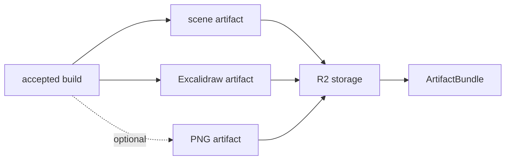

```ts
interface ArtifactBundle {
  artifactId: string;
  diagramId: string;
  formats: ArtifactFormatRef[];
  provenance?: ArtifactProvenance;
}

interface ArtifactProvenance {
  sourceArtifactId: string;
}

interface PartialArtifactBundle {
  artifactId?: string;
  diagramId?: string;
  formats?: ArtifactFormatRef[];
}

interface ArtifactFormatRef {
  format: ArtifactFormat;
  mimeType: string;
  url?: string;
  expiresAt?: string;
  inline?: unknown;
  sizeBytes?: number;
}
```

The first implementation should support:

- `scene`: rendered deterministic scene JSON.
- `excalidraw`: portable Excalidraw scene JSON.
- `png`: hosted visual proof rendered by the Studio Worker through Cloudflare
  Browser Run when requested.

The storage contract is consistent across environments: artifacts are written
as a manifest plus one object per format. A patched artifact manifest records
`provenance.sourceArtifactId`, so every stored format resolves to the same
durable source reference; root build artifacts omit provenance. Studio Worker
deployments bind `SKETCHI_ARTIFACTS` to R2 so
`buildFlowchart/buildMindmap/buildSequenceDiagram/createCanvas -> getArtifact -> applyDiagramPatch` can cross request
boundaries.

| Environment       | Bucket                                         |
| ----------------- | ---------------------------------------------- |
| Preview Workers   | `sketchi-studio-codemode-artifacts-preview`    |
| Production Worker | `sketchi-studio-codemode-artifacts-production` |

Local tests may still use the in-memory store, and local Worker development may
use Wrangler's local R2 storage unless remote bindings are enabled. Those are
dev fallbacks only; deployed Workers should use the R2-compatible binding.

`png` is a stored binary format. It is never returned inline in MCP JSON
responses; fetch raw bytes from the Studio API with
`GET /api/v1/artifacts/{artifactId}?format=png&raw=true`.

MCP `execute` results go to a model, so Code Mode builds and patches run
there inline nothing unless `inlineArtifacts` asks for it: a result names each
logo by its slug and never carries its SVG. The HTTP API keeps the defaults
above. An inline format carries each logo once:
the scene's `icons` map holds each slug's recipe, SVG, or both, as the scene
draws them, and the Excalidraw `files` map one image per distinct embedded SVG. Native Excalidraw JSON is large and noisy, and
most agents should not inspect or rewrite it directly; read stored formats
through their URLs or `getArtifact` instead.

## `getArtifact`

`getArtifact` retrieves a stored artifact format by `artifactId`. `diagramId`
is semantic and not unique enough for retrieval.

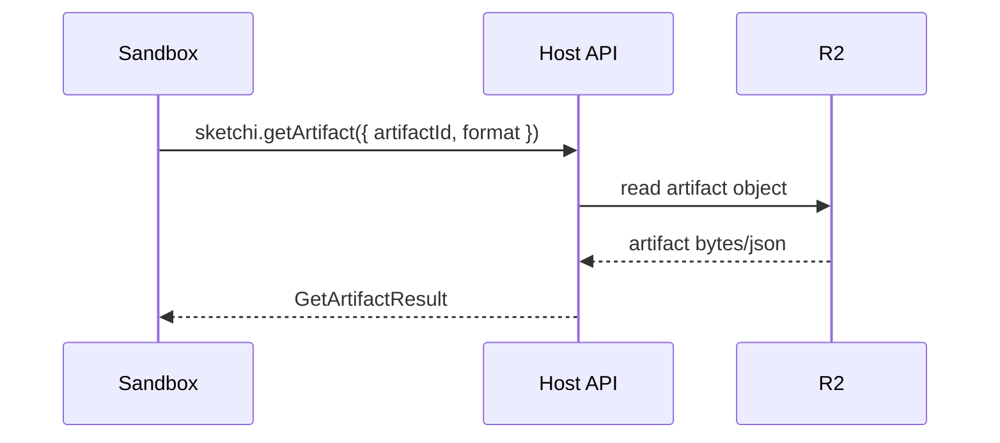

```ts
interface GetArtifactRequest {
  artifactId: string;
  format?: ArtifactFormat;
  inline?: boolean;
}

type GetArtifactResult = GetArtifactSuccess | GetArtifactFailure;

interface GetArtifactSuccess {
  ok: true;
  artifactId: string;
  diagramId: string;
  format: ArtifactFormat;
  mimeType: string;
  url?: string;
  expiresAt?: string;
  inline?: unknown;
  sizeBytes?: number;
  provenance?: ArtifactProvenance;
}

interface GetArtifactFailure {
  ok: false;
  status:
    | "invalid_input"
    | "not_found"
    | "format_unavailable"
    | "expired"
    | "storage_failed";
  issues: Issue[];
}
```

## `applyDiagramPatch`

`applyDiagramPatch` is the codemod-style operation for deterministic visual
changes after a flowchart, mindmap, sequence, or canvas artifact has already been accepted. It should handle
common user requests such as changing colors, switching node shapes, shifting a
group, replacing text, or rerouting edges without asking the agent to edit raw
Excalidraw JSON.

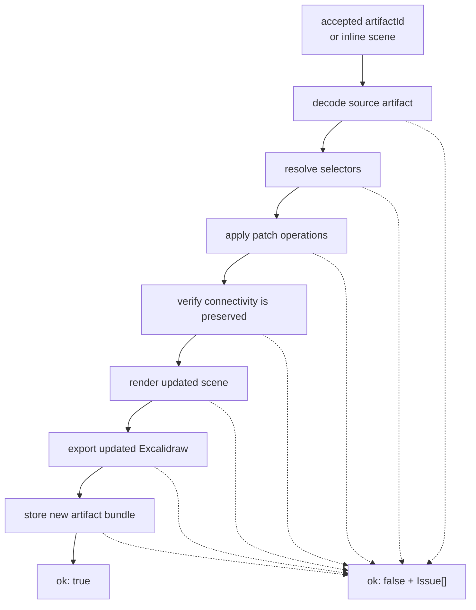

Patch operations must be structured and executable. The optional `intent` field
is only for traceability, docs, and debugging. It must not be the source of
truth for what changes are applied.

```ts
interface ApplyDiagramPatchRequest {
  requestId?: string;
  source: DiagramPatchSource;
  operations: DiagramPatchOperation[];
  options?: ApplyDiagramPatchOptions;
  intent?: string;
}

type DiagramPatchSource =
  | {
      artifactId: string;
      format?: "scene";
    }
  | {
      scene: unknown;
    };

interface ApplyDiagramPatchOptions {
  artifactFormats?: ArtifactFormat[];
  inlineArtifacts?: InlineArtifactFormat[];
  preserveConnectivity?: boolean;
}
```

Defaults:

```json
{
  "artifactFormats": ["excalidraw", "scene"],
  "inlineArtifacts": ["scene"],
  "preserveConnectivity": true
}
```

Initial operation set:

```ts
type DiagramPatchOperation =
  | {
      op: "setDefaultStyle";
      style: DiagramStylePatch;
    }
  | {
      op: "setStyle";
      selector: DiagramSelector;
      style: DiagramStylePatch;
    }
  | {
      op: "setShape";
      selector: DiagramSelector;
      shape: DiagramShape;
    }
  | {
      op: "translate";
      selector: DiagramSelector;
      dx: number;
      dy: number;
    }
  | {
      op: "replaceText";
      selector: DiagramSelector;
      text: string;
    }
  | {
      op: "rerouteEdges";
      selector?: DiagramSelector;
    }
  | {
      op: "insert";
      elements: CanvasElement[];
      beforeId?: string;
      afterId?: string;
    }
  | {
      op: "remove";
      selector: DiagramSelector;
    }
  | {
      op: "replace";
      id: string;
      element: CanvasElement;
    }
  | {
      op: "reorder";
      ids: string[];
      beforeId?: string;
      afterId?: string;
    }
  | {
      op: "group";
      ids: string[];
      groupId: string;
    }
  | {
      op: "ungroup";
      ids: string[];
      groupId?: string;
    };

interface DiagramSelector {
  ids?: string[];
  nodeIds?: string[];
  edgeIds?: string[];
  kinds?: FlowchartNode["kind"][];
  labels?: string[];
  scope?: "all" | "nodes" | "edges";
}

interface DiagramStylePatch {
  strokeColor?: HexColor;
  fillColor?: HexColor;
  textColor?: HexColor;
  backgroundColor?: HexColor;
}

type DiagramShape = "rectangle" | "diamond" | "ellipse" | "circle" | "polygon";
```

Canvas artifacts additionally support insert, remove, replace, reorder, group,
and ungroup operations with stable element ids. Connectivity remains protected
by default and may be changed only when `preserveConnectivity` is explicitly
false. See [CanvasSpec v1](canvas-spec.md) for the canonical scene contract.

```ts
type ApplyDiagramPatchResult =
  ApplyDiagramPatchSuccess | ApplyDiagramPatchFailure;

interface ApplyDiagramPatchSuccess {
  ok: true;
  status: "accepted";
  patchId: string;
  requestId?: string;
  sourceArtifactId?: string;
  artifact: ArtifactBundle;
  issues: Issue[];
}

interface ApplyDiagramPatchFailure {
  ok: false;
  status:
    | "invalid_input"
    | "source_unavailable"
    | "target_not_found"
    | "unsupported_operation"
    | "connectivity_changed"
    | "render_failed"
    | "export_failed"
    | "storage_failed";
  patchId?: string;
  requestId?: string;
  sourceArtifactId?: string;
  partial?: PartialArtifactBundle;
  issues: Issue[];
}
```

Example:

```js
async () => {
  const built = await sketchi.buildFlowchart({
    spec: {
      title: "Simple approval",
      nodes: { start: "Request", approve: "Approved?", done: "Done", revise: "Revise" },
      edges: [
        ["start", "approve"],
        ["approve", "done", "yes"],
        ["approve", "revise", "no"],
      ],
    },
  });

  if (!built.ok) return built;

  return sketchi.applyDiagramPatch({
    source: { artifactId: built.artifact.artifactId },
    intent: "Make the decision diamond purple after the flow is accepted.",
    operations: [
      {
        op: "setStyle",
        selector: { nodeIds: ["approve"] },
        style: { strokeColor: "#7c3aed", fillColor: "#ede9fe" },
      },
      {
        op: "setShape",
        selector: { nodeIds: ["approve"] },
        shape: "diamond",
      },
    ],
  });
};
```

## Expected Agent Loop

The harness should write a spec, call `buildFlowchart`, inspect structured
issues, patch the spec until graph acceptance, and then apply structured visual
patches. Styling is never the first acceptance target.

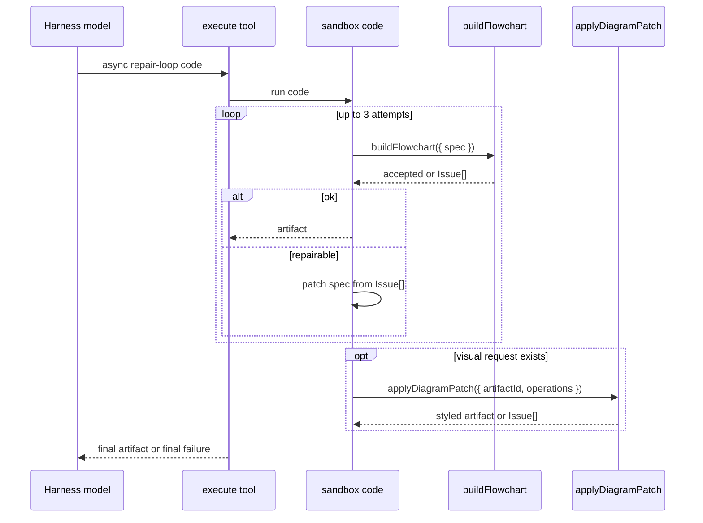

Example sandbox code:

```js
async () => {
  let spec = {
    title: "Incident triage flow",
    nodes: {
      report: "Report received",
      severity: "Severity high?",
      page: "Page responder",
      queue: "Queue for review",
    },
    edges: [
      ["report", "severity"],
      ["severity", "page", "yes"],
      ["severity", "queue", "no"],
    ],
  };

  for (let attempt = 0; attempt < 3; attempt += 1) {
    const result = await sketchi.buildFlowchart({ spec });
    if (result.ok) {
      return result.artifact;
    }

    // Real agents should patch from result.issues. This tiny fallback shows
    // the intended control flow without making the example its own repair engine.
    const missingLabels = result.issues.filter(
      (issue) => issue.code === "unlabeled_decision_branch",
    );
    if (missingLabels.length === 0) {
      return result;
    }
  }

  return { ok: false, error: "Unable to produce an accepted flowchart." };
};
```

## Implementation Shape

The Worker can implement the host APIs as route handlers, in-process service
functions, or both. The contract stays the same.

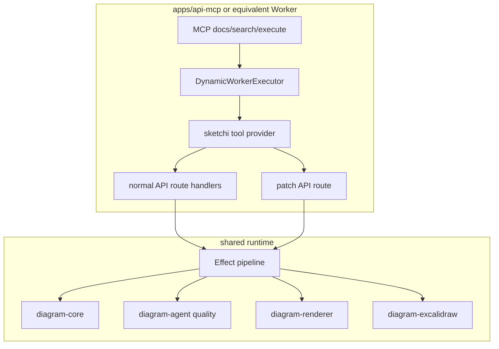

Recommended first slice:

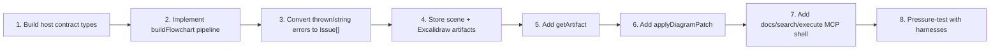

## Non-Goals

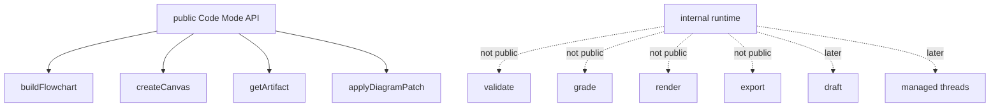

Out of scope for this document:

- Managed thread APIs.
- Convex run or artifact history.
- User artifact library.
- Auth policy details beyond "host-owned".
- PDF rendering beyond PNG.
- Free-prompt drafting.
- OpenAPI search/execute over a large generated spec.
- Direct public tools for validation, grading, rendering, or export.
- Agent-facing raw Excalidraw editing as the primary mutation contract.

## References

- [MCP-first generation scope](mcp-first-generation.md)
- [Code Mode Next PR Plan](codemode-next-pr-plan.md)
- [Agentic generation architecture](agentic-generation.md)
- [System architecture](architecture.md)
- Cloudflare Code Mode documentation:
  <https://developers.cloudflare.com/agents/model-context-protocol/protocol/codemode/>
- Worker Loader documentation:
  <https://developers.cloudflare.com/workers/runtime-apis/bindings/worker-loader/>
