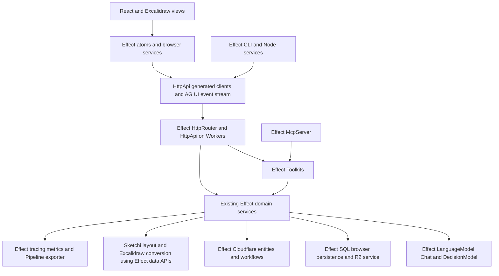

# Effect adoption across Sketchi

Status: proposed implementation plan, revised after independent Claude Fable 5.2/high review on 2026-11-14 against main `2b4ad29d`. The review receipt records the final review state. This task produces a plan, not product changes.

## Decision

Use Effect v4 and its ecosystem throughout Sketchi. Effect owns application state, data contracts, algorithms for which it provides an implementation, workflows, transports, persistence access, concurrency, configuration, cryptography, observability, and tooling. Alpha, beta, experimental, or unstable status is not a reason to choose another implementation.

Use the actual upstream capability rather than a local imitation wrapped in `Effect.tryPromise`. A native API remains only where Effect cannot provide the required capability. Keep that call in a small Effect service or host adapter and explain the specific missing capability. React rendering, the Excalidraw editor, Cloudflare host callbacks, and the Nx generator contract are such boundaries; they are not exemptions for the application code around them.

Remove the current policy that bans Effect from pure and framework packages. Synchronous calculations can use Effect's synchronous data, collection, graph, schema, and result APIs. They need not allocate a runtime or turn every arithmetic operation into a generator.

Use Nx to generate packages and synchronize project references. Remove tests of scaffolding, upstream behavior, source spellings, and exact package inventories. Every retained test must identify a Sketchi behavior, invariant, real integration boundary, or historical defect it protects.

## What changes from current main

Current main pins the runtime packages to `4.1.2`; two architecture documents still say `4.1.1`. The published runtime and matching ecosystem packages are `4.1.4`, released on 2026-11-11. Registry `beta` and `rc` tags point to older releases, and `snapshot` points to a 2024 release; selecting those tags would go backward. Use the newest useful published API, including experimental exports, and evaluate a newer source commit only if it supplies a concrete missing capability. Resolve and pin the version again at implementation start. [Runtime metadata](https://registry.npmjs.org/effect/latest), [release tags](https://registry.npmjs.org/-/package/effect/dist-tags).

Effect already owns much of the server orchestration. The main gaps are application state and browser persistence, handwritten HTTP clients, AI SDK chat and tool wrappers, SDK-based MCP transport and schema adaptation, D1 access, native utility and crypto code, scripts, and custom enforcement. The browser rendering pool already uses Effect `Pool` and `RcMap`; preserve that work rather than claiming it needs a second migration.

The workspace has 23 Nx projects and 423 test/spec files containing 110,539 lines under `apps`, `packages`, `tools`, and `scripts`. These are file and line counts, not executed test counts or a verdict on usefulness. The temporary proof checkout under `.memory` and dependencies are excluded. The per-file survey is in `.memory/effect-everywhere-2026-11-14/test-inventory.json`; the proposed suite dispositions are in `test-disposition.csv` in that directory. These are planning evidence, not new CI inventories.

## Capability map

This covers every public namespace of the published core package and every family in the official v4 package catalog. The implementation choices below come from the published `4.1.4` source, not examples for v3 or the July beta. The companion capability survey records narrower limits and source locations. [Official catalog](https://effect.website/docs/v4/api).

| Area | Effect capability | Sketchi decision |
| --- | --- | --- |
| Services and resources | `Context.Service`, `Layer`, `Scope`, `ManagedRuntime`, `Effect.fn`, fibers and finalizers | One application composition per host; business APIs return Effect. Dependencies are explicit. No parallel Promise-first services. |
| Data and failures | `Schema`, brands, tagged unions/errors, `Data`, `Result`, `Option`, `Match`, `Equivalence`, `Order`, `Hash` | Canonical domain, wire, persisted, event and configuration schemas; exhaustive state transitions; typed expected failures. Derive representations instead of maintaining parallel interfaces. |
| Collections and algorithms | `Array`, `Record`, `Struct`, `HashMap`, `HashSet`, mutable variants, `Graph`, `Trie`, `Differ`, `Optic`, `JsonPatch`, `JsonPointer` | Replace duplicate generic utilities and graph traversal/cycle/topological algorithms. Retain Sketchi layout and geometric algorithms that upstream does not implement. Preserve deterministic IDs and ordering explicitly. |
| Time, numeric and byte values | `Clock`, `DateTime`, `Duration`, `Cron`, `Schedule`, `BigDecimal`, `Rational`, `ByteSize`, `Bytes`, `encoding/*` | Replace application clocks, polling/backoff, date conversions, byte/encoding helpers, and exact counters where relevant. Do not change pixel rounding or numeric wire formats accidentally. |
| Concurrency and resilience | `Queue`, `PubSub`, `Deferred`, `Latch`, `Ref`, `SynchronizedRef`, transactional `Tx*`, `Semaphore`, `PartitionedSemaphore`, `Pool`, `RcMap`, `Cache`, `ScopedCache`, `RequestResolver`, `RateLimiter`, `CircuitBreaker` | Replace handwritten queues, subscription stores, timers, bounded concurrency and caches with the applicable primitive. Domain policies still specify limits, ordering and idempotency. Do not add retries or circuit breakers to operations that have no such requirement. |
| Streaming | `Stream`, `Sink`, `Channel`, `Pull`, `ChannelSchema`, sockets and SSE HTTP support | Own chat events, body limits, progress, debounce/coalescing, cancellation and backpressure. Convert to host streams at the outer boundary only. |
| Browser state | `effect/reactivity` atoms, registries, `AsyncResult`, invalidation, `AtomHttpApi`, `AtomRpc`, hydration; `@effect/atom-react` | Replace React Query and bespoke external stores with atoms. Migrate stateful UI controllers as well as network caches. React hooks consume atoms and render; they do not own asynchronous application workflows. |
| Browser platform | `@effect/platform-browser`: typed IndexedDB, persistence, Web Storage, event streams, workers, clipboard, sockets, permissions, crypto and browser runtime | Replace `idb-keyval`, manual storage/listener adapters and supported browser API wrappers. Preserve existing databases and keys. Browser worker offload is available if measured main-thread work warrants it. |
| HTTP | `effect/http`, `effect/http-api`, generated clients, middleware, OpenAPI, `HttpApiTest` | Shared typed contracts for product HTTP APIs; generated clients in browser and CLI; Effect routing and request lifecycle on Workers. Remove handwritten request/response decoding and status mapping where derivable. |
| RPC | `effect/rpc`, `RpcSchema`, client/server protocols, middleware, streams, `AtomRpc`, test helpers | Use for internal actor operations and any first-party operation that benefits from streaming RPC. HTTP APIs remain the single public REST contract. Do not expose a second RPC copy of every HTTP endpoint. |
| AI models and tools | `LanguageModel`, `Chat`, `Prompt`, `Response`, `Tool`, `Toolkit`, `Model`, `ExecutionPlan`, `DecisionModel`, embeddings, tokenizer and GenAI telemetry | Replace AI SDK model/tool/loop ownership with Effect. Share domain tool handlers between chat and MCP. Retain the current provider/model behavior while changing orchestration. |
| Chat transport | `AgUi`, `AgUiSchema`, `AgUiServer.endpoint`/`handler`, `Chat.streamText` and SSE codecs | Use the lower-level Effect composition for Studio's turn policy. The experimental convenience `AgUiServer.agent` lacks the concurrency/stream hooks Studio needs; using the lower-level Effect APIs still removes AI SDK entirely. Replace both ends in one chat slice. |
| MCP | `McpServer`, `McpProtocol`, `McpSchema`, `McpClient`, `McpTest` | Replace SDK v1 servers, `agents/mcp`, and custom Standard Schema/MCP adapters. Use Effect schemas and toolkits directly. Prove actual required clients/protocol revisions before removing the old transport. |
| Cloudflare coordination | Experimental `@effect/platform-cloudflare`: `CloudflareCluster`, durable entity programs, workflow engine, persisted queues | Use its supported durable coordination for quota/rate-limit and long-lived job requirements. It is a real Wrangler integration, not a requirement to adopt Alchemy. Its workflow engine uses SQLite-backed Durable Objects, not Cloudflare's separate Workflows product. |
| Storage | `effect/sql`, `SqlSchema`, `SqlModel`, migrations, `@effect/sql-d1`, `@effect/sql-sqlite-do`; `KeyValueStore`, `Persistence`, `PersistedCache`, `PersistedQueue` | Replace custom D1 client plumbing and local/browser key-value abstractions. Use schema-aware operations. Keep explicit blob storage services for R2 semantics absent from these libraries. |
| Crypto and identity | `effect/crypto`, `effect/jose`, platform WebCrypto layers, `SecureRandom`, `Aead`, `Digest`, `Kdf`, signature/MAC/key formats | Replace custom native crypto composition in share links, digests and random IDs with Effect services while preserving existing encrypted bytes, keys and URLs. Never substitute non-cryptographic `Random` for secret or public identity creation. |
| Node and CLI | `effect/cli`, `effect/process`, `FileSystem`, `Path`, `Stdio`, terminal services; `@effect/platform-node` | Effect CLI, filesystem, process lifecycle and runtime for CLI, generators' I/O helpers, release/deploy operators and scenario tools. Native callbacks required by Nx/CI stay tiny. |
| Telemetry and developer tools | `effect/observability`, AI `Telemetry`, `Logger`, `Metric`, `Tracer`, devtools; optional `@effect/opentelemetry` | Reuse upstream lifecycle, span and export machinery. Keep the necessary Pipeline/R2 catalog sink, trace joins and current full-content evidence. Use the external OTel SDK bridge only for an actual SDK integration need. |
| Tests and documentation | `@effect/vitest`, schema-driven `it.prop`/`it.effect.prop`, `TestClock`, `McpTest`, `HttpApiTest`, optional `@effect/doctest`/`docgen` | Use purpose-driven behavioral tests, generated inputs and upstream protocol harnesses. Doctest meaningful public examples instead of copying them into separate assertions. Do not introduce another testing framework. |
| Compiler and lint | `@effect/tsgo` `0.69.0`, upstream Effect diagnostics and Oxlint integration; `@effect/language-service` for TS6 | Prefer the native Effect compiler and diagnostics to our custom TypeScript walkers. It supports TS `7.0.2`; its patched Oxlint path currently supports `1.91`–`1.93`, while this repo has `1.90`. Upgrade that coupled toolchain deliberately. Use the no-patch runner with pnpm's store and the per-project diagnostic ratchet below. |
| Contract generation | `@effect/openapi-generator`, `@effect/graphql-generator` | Generate clients/codecs for actual external OpenAPI/GraphQL contracts. Our own API is schema-first with `HttpApi`; do not reverse-generate a second source of truth. |
| Other hosted systems | Bun/Deno platforms, alternate SQL drivers, other AI providers, GraphQL, event log, general cluster transports | Fully surveyed and available when a Sketchi need exists. Do not add a runtime, database, provider, event-sourcing system or alternate frontend solely to install a package. Existing capabilities use Effect without inventing new product scope. |

## Application structure

Keep the existing domain packages. Add a package only when it has a real independent owner or cross-application consumer; generate it with Nx. Candidate additions are a shared Cloudflare adapter package for repeated binding adapters and a Studio chat package if moving the shared event/tool controller out of `apps/playground` produces an actual reusable boundary. API contracts belong to their domain packages; an application assembles their groups. Do not create an empty generic platform, repository, service-base, runtime-manager or universal adapter framework.

React/TanStack stays only where it supplies rendering, navigation, SSR and build integration that Effect does not supply. All application state, including local controllers and preferences, moves to Effect atoms; a package's React rendering is not an exception for its internals. Remove React Query, `@ai-sdk/react`, AI SDK transport/controllers, and application server-function duplication as those consumers move. The application must not retain two server-state authorities or two chat loops. A route's native loader may call the Effect boundary, but it cannot become a second business layer.

Third-party renderers and Cloudflare bindings are provided as services. Native `Promise`, `Request`, `Response`, event listeners and SDK objects may appear inside the host adapter because the host requires them. All caller-facing composition, error handling and lifecycle around them is Effect. Do not manufacture wrapper APIs merely to rename existing Effect APIs.

## Nx generation

The installed `@nx/js@24.0.3` library generator was inspected with `pnpm nx list @nx/js` and `pnpm nx g @nx/js:library --help`. It supports `oxlint`, `oxfmt`, Vitest, tags, buildability and project configuration. `typescript-sync` is available. The checked-in plugin currently generates only UI components and diagram types; it is not a package generator.

1. Use `@nx/js:library` for new libraries, with explicit path/import identity, ESM, tags, and the build strategy established in slice 1b. First normalize the solution tsconfig layout in slice 2, then adopt `@nx/js:typescript-sync` and `nx sync:check`. Today's root points directly at `tsconfig.lib.json`; the installed sync generator expects project-directory/`tsconfig.json` references and would otherwise add duplicate roots.
2. Prefer built-in generator options and root generator defaults. Add one thin `effect-library` composition in `@sketchi/generators` only for repeated Effect-specific choices that the built-in generator cannot express. Compose upstream generators; do not copy their implementations.
3. Enable upstream Nx inference where it actually covers the executor/tool. Keep project-specific Worker, Storybook, browser and corpus targets. Nx 24's Vitest integration is in `@nx/vitest`, not the removed `@nx/vite:test`; install/use the actual plugin if inference is chosen.
4. Default to no generated sample test. Configure a runner when a package first has a real behavioral test. Remove the current UI/core templates that generate trivial render/fixture assertions. Keep Storybook examples when they exercise a visible family/component behavior.
5. Normalize existing package configuration incrementally using a generated reference project in an in-memory Nx Tree or disposable fixture workspace. The actual installed library generator rejected a `--dry-run` probe; no output was generated or validated by that probe. Never regenerate over domain source. The current custom paired TS6/native commands are not automatically reproduced by `@nx/js:library`: compare its real output after the compiler decision. Do not add a test that snapshots Nx's emitted configuration or enumerates the workspace a second time.
6. Keep one generator integration test for our composition: generate a package, consume its actual exports from a second generated project, typecheck/build, run one meaningful service substitution test if generated by our code, and prove a second invocation cannot overwrite user code. Test title/identifier escaping only where our template interpolates it.

Nx generation removes our scaffolding ownership; it does not prove generated business code or eliminate every test in a generated package. [Nx generation](https://nx.dev/docs/features/generate-code), [sync generators](https://nx.dev/docs/features/synchronize-code).

## Ownership across all current projects

Every current Nx project has an owner below. The native column names an actual host/renderer boundary, not permission to leave the project's application internals unchanged. Each owning slice audits all its source and test cases against the diagnostic and retention rules. Slice 0 gives each behavioral suite one owner; cross-slice fixtures are temporary acceptance inputs, not permanent duplicate suites.

| Project | Owning slices | Native boundary that remains |
| --- | --- | --- |
| `playground` | 4 HTTP/runtime, 5 MCP, 6b chat, 7 UI/controllers, 8 DO, 9 export | React/TanStack page rendering; Cloudflare loader/browser/binding calls inside typed services |
| `icons` | 4 APIs, 5 MCP, 6a query atoms, 7 selection/preferences, 8 limits | React/TanStack rendering/navigation; host request/DO callbacks |
| `excalidraw` | 6a query atoms, 7 editor/controller state | Excalidraw/React rendering and editor callbacks |
| `web` | 4 replace `surface-urls-rpc`/server API policy, 7 interaction state | Marketing React/SSR/navigation and asset rendering |
| `sketchi-cli` | 4 generated API clients, 9 commands/I/O/crypto | Node entry callback, actual OS clipboard/browser/raster backends unsupported by Effect |
| `native-conversion-storybook` | 2 configuration, 7 stateful stories, 10 test review | Storybook/Vite configuration contract and React preview rendering |
| `diagram-core` | 3a contracts/failures, 3b graph/data | Primitive arithmetic/typed arrays; measured local loop exceptions only |
| `diagram-renderer` | 3c onward, one family per slice | Domain layout/text geometry arithmetic; measured local loop exceptions only |
| `diagram-excalidraw` | 3c onward conversion/edit/routing unit | Excalidraw wire shapes and domain geometric calculations |
| `diagram-agent` | 3a typed domain results, 5 shared tools, 10 consolidation | External sandbox/blob/browser services at explicit adapters |
| `diagram-generation` | 3a/3b data, 4 typed API, 6c Jev/provider normalization | Credential-free gateway/AI binding transport only |
| `diagram-scenarios` | 3b deterministic utilities, 9 CLI/browser tooling | Browserbase/Playwright foreign calls and host CLI callbacks; graded evals remain in Frontierclimb |
| `diagram-ui` | 7 all state/workflows, 3c conversion consumers | React/Excalidraw render and imperative editor boundary |
| `icon-catalog` | 3b data/algorithms, 9 generated-asset operators | SVG/domain mark data and filesystem generator host callback |
| `community-icons` | 3a models, 4 API contract, 8 SQL/limits | D1 binding only through upstream SQL or a demonstrated unsupported operation |
| `icon-draw` | 6c author/judge, 8 job requirements, 3b data | Browser/raster imaging engine and gateway binding transport |
| `studio-projects` | 3a models, 4 API/client, 7 drafts, 8 storage | R2-specific blob/conditional-write adapter |
| `observability` | 4 request middleware, 5/6 path parity, 9 exporter internals | Pipeline/catalog destination sink |
| `svg-excalidraw` | 3c onward SVG proof unit | SVG/geometry/Excalidraw domain semantics and measured primitive loops |
| `social-card` | 3b transformations, 9 render operator | Actual raster/font engine, not its surrounding workflow |
| `ui` | 7 stateful components, 9 wordmark operator | React/DOM rendering and font/raster engine |
| `sketchi-generators` | 2 upstream Nx composition | Nx Tree/generator callback contract; Effect owns its substantive helpers |
| `icon-batch` | 6c model consumers, 9 typed operator lifecycle | Browser/imaging foreign SDK adapter and Node main callback |

The only planned additional project is typed `tools/ops` in slice 9, generated with the chosen Nx setup. Other candidate packages require the independent boundary described above before generation; the plan does not preallocate them.

## Test retention rules

A retained case must answer: **what Sketchi outcome can break, what input or sequence exposes it, and what assertion detects that break?** The name should state that outcome. An old incident is useful evidence, not an automatic permanent exemption for a redundant assertion.

Delete or replace a test when it only establishes that Nx emitted a project, Effect decodes an ordinary struct, a generated client matches its generator, an upstream MCP method works, a component renders its fixed label, a literal version/path remains spelled the same, or an implementation uses a particular symbol. Delete the obsolete adapter and its tests together after the replacement proves the application outcome. Do not first port every old test to the new library.

Consolidate duplicate coverage at the lowest boundary that owns the behavior. Use schema-generated property inputs for actual laws, and a few focused examples for failures whose exact form matters. Use `TestClock`/`Deferred`/`Queue` for application time and concurrency; browser animation/frame assertions remain real browser work. Keep real browser and Worker proofs where mocks cannot establish the behavior.

| Retained obligation | Why it is Sketchi behavior | Intended proof |
| --- | --- | --- |
| Diagram meaning and limits | No disconnected required nodes, invalid references, unsafe patches, excessive issue amplification or unsupported family claims | Domain property tests and a small named regression corpus; do not retest Schema primitive validation at every layer |
| Geometry and editing | Arrows remain attached and clear, labels stay readable, movement preserves routes and ordering | Bounded generated geometry properties, historical minimal seeds, real Excalidraw edit and exported PNG inspection |
| Atomic publication and storage | A failed artifact write cannot expose a partially published artifact; ownership must prevent cross-session access | Real storage adapter integration plus domain failure/substitution tests |
| Draft/save ordering | Edits arriving during a save are not lost; clearing a saved draft cannot resurrect an earlier queued write | Deterministic queue tests plus browser save/reload/reopen proof with existing IndexedDB data |
| Quotas and spending | Concurrent callers cannot take the same final slot; retries and UTC clock movement do not reopen a budget | Entity/DO integration with persisted state, contention and time boundaries |
| AI run behavior | Tool failures remain repairable; one build runs at a time; steps/tokens/history remain bounded; cancellation reaches upstream; fresh turns remain fresh | Model/tool tests retain compact `toModelOutput`, compact replayed history, pinned last saved build, 64-message/32,000-character caps and a single retry of an empty output-limited run; same Frontierclimb inputs before/after |
| Streaming UI | Partial tool input, message IDs and final artifacts remain coherent; held text is released only after the build verdict; rejected-build and ran-out closing replies and useful provider errors survive | One controller suite over AG-UI events plus real-page success/cancel/failure/retry; retain pre-stream 400/413/503 behavior |
| SSR and preferences | Browser-only queries remain browser-only; SSR owners share no state; raw `on`/`off` preferences retain cross-tab sync and failed-write behavior | Real SSR requests produce no query I/O or orphan fibers; browser storage-event and failure cases exercise the atom controller |
| MCP and HTTP contracts | The configured endpoints expose the expected Sketchi tools/results and preserve ownership/cancellation | `McpTest`/`HttpApiTest` for app semantics plus a minimal real Worker protocol smoke |
| Offline CLI and encrypted shares | Offline commands stay offline; writes retain durability/symlink protection; share/pull decrypt existing bytes | Bundled CLI smoke, filesystem edge cases and persisted/encrypted fixture round-trips |
| Telemetry | One request/run can still be joined to its gateway log, artifact and retained span rows without dropped fields | Capture sink test plus one live correlated request and a retained-data query |
| Deployment ownership | Preview cleanup cannot delete a production or another owner's resource | Focused negative/ownership tests for our decision logic; no source-string workflow tests |
| Accessibility and interaction | Keyboard/focus/selection behavior and actionable failures remain usable | Component behavior where isolated; real browser for focus, editor and layout integration |

Concrete first deletion targets are the per-file Promise counts and custom compiler machinery in `tools/project-graph.test.ts`, after the upstream diagnostic ratchet exists; pure/framework Effect bans; rules/docs for the retired `effect/unstable/*` path (absent from current package exports); SDK peer alignment tests after removing `agents/mcp`; `schema-adapters.server.test.ts` after removing that adapter; and tests of old fetch/queue/transport implementations replaced by upstream facilities. `tools/diagram-families.test.ts` contains useful behavioral pipeline coverage: keep that behavior and remove only its file-existence/docs-coupling assertions. Review font packaging and deployment tests individually: missing font subsets and wrong deployment ownership are real product defects.

The captured `http-status-compatibility-v1.json` and `mcp-validation-issues-v2.json` fixtures are actual before-state oracles, not hypothetical compatibility tests. Replay them once through the replacement HTTP/MCP handlers before deciding which cases remain. The HTTP corpus covers flowchart, mindmap, getArtifact, applyDiagramPatch and requestTooLarge; it does not cover the CLI's generate route. Existing released CLI consumers of `/api/v1/generate`, `/api/v1/canvases/create`, `/api/v1/icons/draw` and Icons `/api/community` are real: retain all four wire contracts with no parallel codec/version shim. Their oracles are the released CLI's actual success/error decoders, including `GenerateApiSuccess` and `EndpointErrorBody`, and the existing installed-CLI generation test. `HttpApiTest` and `McpTest` are in-memory clients; neither proves Worker binding/isolates, middleware order, streaming backpressure or these bodies.

Before deleting an application case, give the independent reviewer its removed title and replacement owner, or the reason it covers no application behavior. For the few costly invariants—last quota slot, UTC rollback, stale draft resurrection, partial artifact publication and cross-session ownership—demonstrate once that the replacement test fails when that invariant is broken, then remove the deliberate break. This is a transient review receipt, not a new manifest or mutation-testing framework. Track removed tests, retained obligations, local gate time, flake rate and source/adapter code removed. Do not promise a percentage reduction before that audit or trade domain confidence for a line-count target.

## Implementation sequence

Each slice removes its superseded path before acceptance. A short development flag is acceptable only inside an unmerged slice; do not accumulate two implementations on main. Preserve current behavior unless a wire/storage change is explicitly part of the slice. Existing persisted data requires a real inventory and migration; hypothetical compatibility callers do not justify shims.

The dependency order is 0 → 1a → 1b → 1c → 2. Then 3a contracts precede affected API work in 4; 3b and family-sized 3c slices can ship independently of 4. Convert the small query surfaces in 6a after their slice-4 contracts, before chat 6b; 6b depends on shared tool definitions from 5a, not the MCP transport rollout in 5b. Slice 6c's provider work is independently reviewable. Slice 7 owns local state/preferences/drafts once atoms are proved. Slice 8 requires its data/host prototypes from 0 and the relevant substrate; slice 9's scripts/crypto/exporter parts ship separately, with request telemetry protected in 4–6. Slice 10 closes remaining audited scopes. "Slice" denotes a proof unit, not permission to combine every subpart into one PR.

### 0. Baseline and persisted data inventory

Capture current rendered outcomes and costs through the real entrypoints: Studio chat, direct generation, MCP docs/search/execute, icon draw, project save/reload/edit, encrypted CLI share/pull and offline CLI. Use the same Frontierclimb catalog revisions, provider/model, cache policy and prompts for before/after comparisons; do not add local graded eval catalogs.

Inventory actual R2 prefixes and record shapes, D1 schema/rows, existing Durable Object identities and counters, CLI record versions, share formats, IndexedDB `sketchi-studio/drawing-drafts`, and browser preference keys. Use bounded read-only samples and counts; report bytes/rows/operations and migration cost before changing a stored shape. Local browser data that cannot be centrally enumerated must be migrated lazily by version at opening, without deleting drafts. No destructive migration is implied by the refactor.

Read existing MCP initialize/client/protocol records from retained request spans before choosing transport. Inspect both servers and confirm configured clients directly where logs are absent. Capture status/body per outcome class for all four released-CLI routes that the v1 HTTP corpus does not cover, and preserve the current released CLI build as a decoder/behavior oracle. Inspect whether Frontierclimb uses `/api/chat`; if so, update its transport adapter alongside the app while holding scored cases/inputs fixed and recording both catalog revisions. Query failures/lost jobs around eviction/deploy before selecting durable Workflow: use it for a demonstrated resume requirement, otherwise retain request-scoped workflows.

Record per-family wall time and peak memory on named deterministic inputs, confirming that replay on unchanged code is repeatable first. The default refactor budget is at most 10% regression in median wall time (or 5 ms for very small inputs, whichever is larger) and 15% peak-memory growth (or 8 MiB, whichever is larger), using the same machine/runtime and repeated warmed runs. Exceeding either requires optimization or a separately justified product tradeoff; it cannot silently justify a permanent native implementation. These are migration thresholds, not a new timing-sensitive CI suite.

**Exit:** named behaviors/current proof; suites assigned to the first slice changing their behavior (or explicitly to slice 10's no-change audit); actual data shapes or an inaccessible dataset; MCP protocol/host decision; four-route CLI oracles; per-family performance thresholds; token/call/retry/bundle baselines. The CSV's project defaults must be corrected during this review; they do not establish case-level ownership by themselves. No persisted-shape migration proceeds on assumed data.

### 1a. Effect substrate

Upgrade existing matching runtime/provider/test packages to `4.1.4` (or a newly verified superseding version) in a behavior-neutral slice. Add each new atom/browser/provider/SQL/Cloudflare package only in the slice that first imports it. Use one pnpm catalog for the synchronized runtime line; tools such as `@effect/tsgo` have their own versions and must not be incorrectly forced to `4.1.4`.

**Exit:** unchanged application behavior passes the affected gate and actual entrypoint smokes, with updated bundle measurements.

### 1b. Compiler and lint toolchain

Adopt `@effect/tsgo` with its supported TS7 and Oxlint versions using its direct runner, without patching pnpm's shared store. Keep TS6 only where an actual Nx/compiler integration still requires its compiler API or emit; prove compatibility before removing either existing compiler gate. Enable correctness and Effect-native diagnostics; disable maturity-only rejection of experimental/unstable APIs. Do not switch every style suggestion to a hard error.

**Exit:** affected projects compile and lint through upstream runners; existing Nx build/emit consumers and generated declarations still work. Upgrade the matching Oxlint plugin/tooling versions, not just its executable.

### 1c. Policy and an upstream diagnostic ratchet

Replace the old ADR/conventions and lint rules that ban Effect from UI/pure packages or refer to the now-absent `effect/unstable/*` path. Enable upstream correctness errors and enable the Effect-native diagnostic group as warnings for unconverted projects. Record its initial per-project counts in temporary slice evidence. Each converted project/family promotes its applicable group to error; final acceptance is errors across the workspace, with each necessary native operation carrying an inline suppression and a concrete reason. Retain the existing reason-on-suppression rule.

The relevant upstream rules include `asyncFunction`, `newPromise`, `globalFetch`, `globalTimers`, `globalDate`, `globalJson`, `globalRandom`, `globalConsole`, `cryptoRandomUUID`, `nodeBuiltinImport`, `processEnv`, `schemaSync`, `extendsNativeError`, `preferEffectArray`, `preferEffectRecord`, `preferEffectString`, `runEffectInsideEffect` and `strictEffectProvide`. Configure the rule according to function purpose: synchronous domain Schema construction/decoding is deliberate and can carry its local reason; it is not a package-wide exemption. Disable `experimentalApiUsage` and `unstableApiUsage` as maturity barriers. Nonapplicable style suggestions need not be errors.

Only after those diagnostics run, remove exact Promise-site inventories and duplicate compiler walkers. Keep dependency isolation and genuine host-edge checks through Nx/the existing lint system; do not rebuild a syntax census. Unconverted projects stay visible in diagnostic output, not in a new hardcoded inventory. Add no remote CI.

**Exit:** Effect imports are permitted throughout, the new diagnostics catch actual discarded effects/missing requirements and native orchestration, and the removed compiler census has an active upstream replacement.

Freeze the diagnostic rule set and levels once in slice 1c's configuration for domain, server, React-app and tooling classes. Correctness is error everywhere. The listed native-operation/collection rules start at warning in unconverted code and become error in converted scopes; synchronous domain-schema diagnostics retain their explicitly selected level, while server I/O boundaries require effectful decoding. Experimental/unstable maturity diagnostics are off. Later slices promote this fixed set and may not narrow it without independent review. Required native JSX/host callbacks and measured loops use local reasoned suppressions, not a weaker project profile.

### 2. Nx package generation and reference ownership

Depends on 1b's compiler decision. First normalize root references to project directories/`tsconfig.json`; each library's solution config references its lib/spec configs. Prove root build mode and affected checks once against that layout. Then implement the generation choices above, enable `typescript-sync`/`nx sync:check`, and remove the hardcoded project-root/composite-reference tables. Touch `nx.json`, the existing generator plugin, package/tsconfig configuration and the local gate only as needed. Keep a single package/version policy in pnpm.

**Exit:** a generated reference package integrates and builds, TS references remain synchronized, affected execution discovers changed consumers, placeholder tests are absent, and the obsolete project inventory checks are removed.

### 3a. Domain contracts and typed failures

Migrate `diagram-core` contracts and shared models to Effect data APIs without geometry changes. Derive types/unions from Schema. Expected failures use `Result` or tagged errors rather than throwing across application function boundaries; meaningful absence uses `Option`; ordering uses `Order`; branch/state exhaustiveness uses `Match` or Schema-derived union helpers. Apply the same rule to internals, not only exported wrappers. Keep native `undefined` only where a host/wire shape requires it, at that boundary.

**Exit:** existing schema/wire fixtures decode identically, invalid inputs produce the same useful domain failures and bounds, the converted scope has no unexplained native/throw/absence paths, and its diagnostic group is at error.

### 3b. Generic graph and utility algorithms

Replace generic traversal/cycle/SCC/topological code with `Graph`, preserving stable domain-ID mappings and ordering. Replace duplicate encoders, date/byte/string/collection utilities with upstream implementations. Use Effect mutable collections in measured hot paths. Arithmetic and typed arrays are native values; a benchmark-named loop may retain a native collection only with a local reason and proof that the supported Effect alternatives do not meet the required runtime budget.

**Exit:** deterministic differential replay shows identical domain/graph results, slice 0's measured runtime/memory thresholds pass, meaningful failure/order properties pass, local replacements and their generic unit suites are deleted, and converted diagnostics are errors.

### 3c onward. One rendering proof unit per slice

Convert internals one family at a time, using the existing full family fuzz targets as proof units: flowchart/routing, mindmap, sequence, state machine, Gantt, ER, class, org chart, Venn, journey, Sankey, wireframe, quadrant, timeline and chart. Then convert shared Excalidraw conversion and SVG conversion in separate slices. Include icon catalog/selection algorithms and social-card transformations under their actual owning projects.

Effect has no spatial diagram layout, text metrics, SVG decomposition or Excalidraw editor implementation. Keep those domain algorithms, implemented with Effect's data/results/collection/graph primitives internally. A 40k-line renderer cannot qualify as converted because one exported function acquired an Effect wrapper.

**Exit for each unit:** replay the same deterministic corpus before/after and require byte-identical serialized scenes/artifacts, that family's full fuzz target and slice 0's wall-time/memory thresholds. This is temporary migration proof, not a new permanent snapshot suite. Any intentional output difference requires an explained product/algorithm change and real image/edit proof; it cannot be hidden in the refactor. Promote converted family/files to upstream diagnostic errors. Delete obsolete utility tests; retain minimal named domain failures/seeds.

### 4. Typed APIs and generated clients

Define `HttpApiGroup` contracts beside Studio projects, generation, artifact/canvas operations and icon domains. Assemble them in Worker applications using `HttpApiBuilder`/`HttpRouter`. Dispatch API/MCP routes from `worker-entry.ts`; keep the TanStack handler only for page/SSR navigation. Build module-owned, I/O-free application structure and supply env/request identity/telemetry context at the request edge. Follow the upstream Workers guidance for `toWebHandler`, scheduler and request contexts; never reuse a request-owned binding, socket or current-user state across requests.

Replace `packages/studio/projects/src/client-api.ts`, icon clients and CLI HTTP requests with generated `HttpApiClient` calls. Use typed middleware for anonymous owner/session checks, bounded bodies, origin policy and error status encoding. Expose streaming responses through Effect HTTP streaming codecs. Generate OpenAPI from that one contract.

Move request telemetry into `HttpRouter` middleware now: root request/stream spans, trace/run/attempt/ray IDs, body/header fields, stream-complete state and `waitUntil` export survive before removing the old runtime wrapper. Slice 9 simplifies exporter internals later. Replay the five groups in the captured HTTP corpus separately from the four CLI-route oracles; validate those with the last released CLI's own decoders and network commands. Do not claim the v1 corpus covers generate.

**Exit:** browser/new CLI use the same contract; the last released CLI build completes each affected network command against previews for both Worker origins; success/error decoders and captured outcome classes match. Useful failures, cancellation, ownership and origin checks pass; old clients/codec glue are deleted. In-memory semantics, the recorded wire corpus and a real preview request per replaced path prove binding/telemetry parity. Measure bundle/startup against slice 0 now, since module routing changes eager evaluation.

### 5a. Shared Effect tools

Move docs/search/execute and icon tools to shared `Tool`/`Toolkit` definitions and domain handlers while the existing transport remains the single serving implementation. Replay validation-issue fixtures and prove tool semantics/receipts. This independently shippable slice unlocks chat 6b without waiting for a transport extension. The existing adapter is removed in 5b; retaining the one current transport during this migration is not a second implementation or the final target.

**Exit:** shared handlers/schemas serve the current tool boundary and the captured validation oracle passes; chat can consume the Toolkit independently of MCP hosting.

### 5b. Effect MCP transport

The transport decision is mandatory in slice 0: `layerHttpRequestScoped` accepts only sessionless revisions such as 2026-07-28 and rejects legacy initialize. `layerHttp` supports older revisions but owns an in-memory session/server fiber; Worker module scope is not cross-isolate session ownership. Use the shared Toolkit with the following host decision.

Use `layerHttpRequestScoped` if every actually configured client supports the sessionless protocol and no broadcast/subscription feature is needed. Otherwise the Effect target is `layerHttp` hosted by a session-owned Durable Object, with a minimal Worker binding/router adapter directing subsequent `Mcp-Session-Id` requests to that owner. Validate the owner-locator/session mapping, initialization races, origin checks, cancellation and client reinitialization after DO eviction/deploy in a disposable preview before the main migration. No per-isolate session map is acceptable. This host adapter fills a demonstrated transport gap; it must not implement MCP encoding or tool execution. If the supported public APIs cannot supply that routing/lifetime correctly, the first slice is the required Effect transport extension with upstream/public API proof; do not quietly keep an SDK transport or claim this slice complete. Session reset/reconnect behavior is an actual-client acceptance gate, not assumed compatibility.

Retain the Cloudflare Code Mode loader/executor as a narrow external service: it is the product's sandbox, not a substitute for Effect orchestration. Replace its surrounding Promise composition, lifetime, concurrency and error translation. Preserve Code Mode receipts, partial results, PNG budgets and artifact visibility.

Remove `effect-mcp-adapter.server.ts`, Standard Schema glue used only for SDK bridging, SDK transport construction and `createLegacyMcpHandler`. Resolve the real `agents/vite` consumer in `apps/playground/vite.config.ts` before deleting `agents`; check any remaining Code Mode loader peer separately. Remove direct SDK/Agents dependencies only when their actual consumers are gone. Replay `mcp-validation-issues-v2.json` through the new server before deciding which failures are product contracts worth keeping. Remove peer/source-inspection tests for deleted dependencies.

**Exit:** actual clients initialize/list/call and obtain artifacts across requests, isolate changes, deploy/reconnect and an idle gap exceeding DO eviction; required notifications/cancellation work. The harness and captured wire oracle pass. Failure cannot erase an accepted receipt. Real preview telemetry parity precedes old-runtime removal; SDK servers/facade are gone.

### 6a. Browser query atoms before chat

After slice 4 supplies the relevant typed clients, replace the five React Query call sites independently, starting with Icons, then the Excalidraw SVG workspace and Playground `use-async-resource`. Use `AtomHttpApi`, invalidation keys and `@effect/atom-react`; declare its `scheduler` peer explicitly. Every app root mounts a `RegistryProvider`; every effectful atom reachable during SSR uses `Atom.withServerValueInitial` or an explicit non-effectful server value. The upstream default registry is module-global and the provider's React cleanup does not run during SSR. Existing queries are browser-only: do not introduce SSR prefetch/hydration as a side effect of this migration. Any deliberately request-owned server registry is disposed in the request scope.

**Exit:** real SSR requests make no query I/O and leave no orphan fiber; two owners share no registry/cache state. Browser query, mutation, error and invalidation behavior passes at each converted call site. React Query is removed only after its final consumer is converted. Local preference/selection stores belong solely to slice 7.

### 6b. Studio chat server and browser together

Use `@effect/ai-openai`'s Responses model with the existing gateway binding/stored key. Capture and diff the before/after gateway payload for the same turn: tool schemas, `strict`, `parallel_tool_calls`, `store`, `reasoning`, `max_output_tokens` and `temperature`, then preserve the intended settings explicitly. The Effect provider defaults to strict transformed tool schemas, so parity cannot be inferred from the model name. Keep provider/model, step/token/freshness/repair policy and billing identity unchanged.

Implement the turn with lower-level Effect APIs: a typed AG-UI endpoint/handler and SSE event codec, `Chat.streamText({ concurrency: 1, maxSteps, ... })`, `Tool.toModelOutput` for compact results, domain stream stages for held text/single empty-output retry/closing replies, and `AgUi.fromStreamParts`. Emit explicit `RUN_ERROR` events with the useful user-facing error where upstream's generic conversion intentionally drops details. Keep request validation/status decisions before opening the stream. The convenience `AgUiServer.agent` exposes no concurrency or stream-policy hooks and is not the target for Studio.

Replace `studio-reply.server.ts`'s AI SDK message-stream code and browser `useChat`/SDK types with `AgUiSchema` events, Effect streams and atoms. Preserve compact replayed history, pinned last saved build, the 64-message/32,000-character limits, partial input and final artifact behavior. Upstream supplies generic events; only Sketchi's turn policy is custom. Publish the new wire at a distinct route (for example `/api/studio/chat`), switch the app to it, and remove the old `/api/chat` implementation. An already-open old tab receives an actionable reload failure rather than misparsing the new stream; no old-wire decoder/dual implementation is retained. Coordinate any actual Frontierclimb transport caller without changing the scored cases.

**Exit:** held text, one build at a time, compact tool/history results, empty output-limit retry, rejected/ran-out replies, pre-stream 400/413/503 and useful terminal errors have purpose-named tests. Real success/partial input/cancel/retry/fresh resubmit/selection/reload work. Gateway payload parity, correlated retained telemetry and Frontierclimb quality/cost receipts pass. No AI SDK chat loop/transport or obsolete wrapper remains.

### 6c. Icon author, judge and Jev providers

Direct generation's existing retry/timeout/repair policy is unchanged by provider reuse. Tests of that untouched policy belong to slice 10's explicit no-change audit; any actual data/API change in 3a/4 takes ownership of the affected cases first. This slice owns only changed provider mappings and their consumers, not every test in `diagram-generation` by default.

Move `packages/icons/draw/src/lib/models.ts` author calls to `@effect/ai-anthropic` and judge calls to the appropriate Effect `LanguageModel`/shared gateway route. Published Anthropic source supports signed/redacted thinking replay, cache controls, images and effort; prove identical required wire blocks/options and cached-token usage before deleting the custom Messages/response parsing. Keep the current model choices, round limits, prompt-cache economics and judging behavior. Remove its generic protocol tests, retaining domain call bounds and provider-metadata replay tests.

Prefer `@effect/ai-typesafe`'s Jev `TypeSafeDecisionModel` over our question/answer mapper. Its `TypeSafeClient` accepts an optional API key and an injected Effect `HttpClient`; adapt that transport to the existing credential-free `AI.run`, normalizing only the binding envelope/model prefix. Compare actual answer/probability shapes before removing the custom schemas/mapping. `@effect/ai-cloudflare` targets Clef REST and is not the matching provider. No new credentials or model change is required merely to reuse the correct provider package.

**Exit:** identical useful author/judge/Jev behavior and settings, thinking/cache/usage/cancellation parity, the same generation cost/quality evidence, and handwritten model protocol/decision translation removed wherever upstream supplies it.

### 7. Browser persistence and effectful interaction

Replace `idb-keyval` and the handcrafted Promise chain with typed IndexedDB services and an Effect coalescing queue. The first Effect schema version must exactly describe the existing version-1 `sketchi-studio` database, `drawing-drafts` store, out-of-line keys, no auto-increment and `StudioDrawing` values. Existing browsers skip the first migration, so it must not be relied on to create/reshape an existing store. Open version 1 without an upgrade. Build the preexisting-data browser fixture using raw IndexedDB, independent of the removed library. Any later version/shape migration is separate, preserves data and handles blocked opens visibly while an old tab is still open. Never use destructive `rebuild` as migration or silently stop capturing drafts on a blocked upgrade.

This slice alone owns all local preference/selection stores across the apps. Use atoms plus `BrowserKeyValueStore`, retaining the existing raw `on`/`off` representation through a literal codec; `Atom.kvs`'s JSON codec would reset it. Preserve cross-tab `storage` updates with a scoped `BrowserStream` listener and preserve the current failed-write in-memory choice. Move other application-local `useState`/reducer/controller policies to atoms; React owns render hooks only. Use browser clipboard/crypto/permissions services, schedules/streams for timer-driven work, and a minimal adapter only for DOM focus/Excalidraw events that Effect cannot supply.

**Exit:** old drafts reopen, rapid edits coalesce without loss, save/clear cannot resurrect stale writes, blocked storage remains usable, teardown releases listeners/fibers, and reload verifies actual persistence. Remove the old storage library and its implementation-specific tests.

### 8. D1, durable coordination and runtime resources

Use `@effect/sql-d1`/`SqlSchema` in community icons and `@effect/sql-sqlite-do` for applicable DO SQLite access. D1's driver does not support `withTransaction`, streaming queries or `updateValues`; `withTransaction` defects. Use its atomic `batch` for atomic work, raw results or `RETURNING` for the current `meta.changes` insert decision, and the existing idempotent `CREATE TABLE IF NOT EXISTS` bootstrap. Do not introduce a transaction-based migrator/migrations table for one table. PR previews share a D1 database, so a preview schema mutation requires isolation or an explicit shared-data migration plan. Keep network/provider work outside DB operations.

Prototype `CloudflareCluster` on a disposable preview, accounting for all four required namespaces/classes and the generated Worker types versus its `@cloudflare/workers-types` v5 dependency. Use non-persisted quota RPCs (avoid permanent mailbox dedup rows), concurrency 1 and an application table through the supported DO SQL service. Entity names persist: use a stable keyed digest of client identity, not a raw address, and explicitly measure retained object/application rows and pruning. Hashing does not make retention free. Preserve last-slot contention, UTC rollback and the existing per-Worker ownership policy. Measure DO requests, rows and billable operations per admission before choosing the host.

Preserve today's budget through a bounded pull migration. On its first admission without an activation record, the new owner calls the old object's idempotent `freeze`; that commits an immutable current-day snapshot/marker, returns the same snapshot on retries and refuses subsequent old-path admissions. The new owner commits the seed plus activation record in one local transaction before admitting anything. The old class needs no cluster client; in-flight callers from the previous Worker revision fail closed. No network call occurs inside either authoritative transaction. Prove interrupted transfer/admission races with both real objects, verify counts, then remove the old class with `deleted_classes` in a subsequent deploy. No reset/dual authority is allowed. If cluster retention/cost/transfer cannot meet these requirements, use Effect SQL programs in the existing DO shells. For the one-minute limiter, drain the full old window before activating the new owner; accept no extra admissions, with a bounded one-window migration delay per client. No permanent limiter migration path remains.

Evaluate the PNG renderer's existing warm-session DO against Effect entity `keepAlive`, scope interruption and eviction semantics. Keep `Pool`/`RcMap` and the necessary Browser Run SDK adapter. Move the application lifecycle into the supported Effect host path when it preserves warm sessions; if a live browser handle cannot survive that path, retain only the minimal DO shell required to own it and record the demonstrated gap.

Use `Workflow`/`Activity`, `DurableClock` and durable deferreds/queues only for the actual lost/resumable jobs identified in slice 0. Otherwise record no current requirement and keep request workflows. Prove idempotent activity boundaries, cancellation, replay and billable attempts; persisting an activity does not make a replayed provider call free or exactly once.

**Exit:** D1 data/constraints remain intact, quota limits survive migration and contention, warm exports retain their intended latency, and any adopted durable job resumes without duplicate publication/billing. No SQL server, Alchemy migration or extra scheduler is introduced merely to enable this package.

### 9. CLI, scripts, crypto and observability

Generate a typed `tools/ops` Nx project for reusable operator scripts now in untyped `.mjs`; migrate their purposeful `node:test` behavior to `@effect/vitest`, deleting source-string tests rather than translating them. Keep `ci-local.mjs` as the minimal pre-install/task-launch bootstrap and preserve required native CI/Nx loader callbacks; all substantive post-install operator policy lives in typed Effect. Migrate `icon-batch` tooling too. Use `effect/process` and Node layers, `NodeRuntime.runMain`, scoped process-tree teardown, HTTP clients, Config, filesystem, paths, clocks and schedules. Keep a real descendant/stdio interruption test rather than a fake process implementation matrix.

Use Effect crypto for encrypted sharing, digests and IDs, preserving existing byte layout, nonce/key/AAD rules, compression and link format. Published Node-shared source implements `noFollow` via `O_NOFOLLOW` and a `sync` operation, but explicitly rejects `noFollow` on Windows. Use upstream exclusive open/sync/scoped close on supported POSIX paths after proof; retain only a required platform-specific fallback if it preserves an actual supported-platform guarantee. Parent-path safety is distinct from final-component no-follow.

Refactor `observability` around upstream spans, AI telemetry and exporters. Keep a narrow Pipeline/catalog exporter for the current retained row format. Preserve request/run/gateway/artifact joins, content fields, chunk reconstruction and error causes. Use request-scoped flush/finalization through Workers `waitUntil` as appropriate; do not start an exporter timer at module scope or lose telemetry when the response stream closes.

**Exit:** offline CLI still works without network; bundled share/pull decodes existing data; actual child trees terminate; retries remain bounded; emitted/retained/queryable correlated telemetry is demonstrated. Remove superseded Promise helpers, crypto wrappers and exporter lifecycle machinery.

### 10. Test consolidation and final removal

Each preceding slice deletes the tests made obsolete by its replacement. This final pass checks remaining cases individually against the retention question, merges repeated fixtures/assertions, removes placeholder generator tests, and leaves clear domain/property/browser suites. Keep small reproducible geometry seeds rather than repeatedly running overlapping large random matrices in the default gate. Retain the full corpus/fuzz targets for changes that affect them.

Remove unused dependencies and old architecture text after verifying consumers. Keep no dual query caches, transport loops, codecs, SQL clients or storage paths. Ensure no test exists solely to enforce the former architectural exclusions. Publish before/after counts, gate time, flake observations, bytes/bundle size and quality/cost receipts without claiming that a smaller suite alone establishes correctness.

**Exit:** all remaining tests have a stated behavior and one owner, the applicable Effect-native diagnostic group is error across all projects, every residual native operation has a local demonstrated reason, all old implementations/dependencies are gone, and real application proof passes. A project cannot pass merely by returning Effect from its exported wrapper.

## Verification and release

Use the repository's current `pnpm ci:local --no-signoff` before each implementation push, then `pnpm ci:local` on the pushed clean head. Refactor its overlapping compiler/project-inventory work in slices 1–2 only after the replacement proves build and diagnostic coverage. No new paid CI, preview queue or synthetic architecture test suite is part of this plan.

Run affected browser, Storybook, corpus/fuzz and Worker dry-run targets when their actual inputs change. Use the real preview/local product page with `agent-browser` or the existing Browserbase integration, including persistence after reload and error/cancellation. Browserless unit tests do not prove hydration, editor interaction, Worker request isolation, service bindings or browser storage.

Before replacing an HTTP/MCP/chat runtime on production, require its real preview proof, actual data migration receipt if applicable, measured bundle/CPU/cold-start impact and the same Frontierclimb quality/cost comparison. A deployment proof records the deployed revision and actual successful request; a local build or in-memory protocol test is not production proof.

Use separate focused implementation slices through normal Graphite review/merge. Respect the requested implementation/reviewer model choices at execution time. This planning task includes the user's explicit Claude Fable 5.2/high review request, which overrides the repository's default prohibition on Fable for this review only.

## Demonstrated boundaries and decisions to resolve in the first affected slice

| Boundary | Current evidence | Required decision/proof |
| --- | --- | --- |
| React renderer, Excalidraw editor, layout/PNG engine | Effect provides state/workflows/data, not these renderers or Sketchi geometry | Keep rendering dependencies; make application state and surrounding operations Effect. |
| TanStack navigation/SSR/build entry | Effect HTTP routing is not a React page-navigation/SSR framework | Retain the page shell until an actual supported Effect replacement exists; move APIs/server state out of it. |
| R2 blobs, metadata/ETag/conditional writes | No R2 blob service in the inspected core/platform-cloudflare exports | Keep one typed adapter with these exact capabilities; avoid reducing it to generic key/value semantics. |
| Cloudflare gateway stored-key binding | Provider packages operate over Effect HTTP; binding supplies credential-free gateway calls | Supply binding transport through Effect HTTP and retain cancellation/response metadata. Do not add new API credentials. |
| Existing Jev family decision provider | `@effect/ai-cloudflare` targets Clef REST; the inspected `@effect/ai-typesafe` supports Jev, optional credentials and injected HTTP | Reuse the TypeSafe provider over binding transport after actual shape proof; remove custom decision/question/answer mapping. Any residual adapter must be limited to a demonstrated binding envelope difference. |
| Durable cluster | New package is experimental since `4.1.3`; not every general cluster operation is implemented | Use the source-supported subset; check methods used and prove preview eviction/replay/cancellation. Experimental status itself is not a rejection. |
| IndexedDB, R2, D1, quota state and share bytes | Actual user data exists in these formats; production contents were not inspected by this planning task | Inventory and migrate real shapes when needed. Runtime adoption alone is not authority to discard records. |
| Compiler integration | Native Effect diagnostics support TS `7.0.2`; Nx/custom tests still use the TS6 API and installed Oxlint is older than supported patched builds | Use supported versions and upstream runners; retain a compiler only for a proven remaining consumer, with a removal condition. |

## Review receipt

Claude Fable 5.2 (`claude-fable-5-2`), effort `high`, independently reviewed the initial plan and current/published source. It returned 15 findings (five high, seven medium, three low), recorded in `.memory/effect-everywhere-2026-11-14/fable-review.md`. The revisions address the shared MCP session owner, concrete internal adoption/family proof units, lower-level AG-UI turn policy, browser-only SSR atom values, early telemetry parity, durable quota transfer/retention, exact IndexedDB/raw preference preservation, upstream diagnostic ratchet, all 23 project owners/icon providers/scripts, real wire oracles and removed-title review, Nx tsconfig layout, smaller slices, D1 limitations, demonstrated workflow requirements and obsolete import-path docs. The coordinator additionally verified TypeSafe provider reuse, Anthropic thinking/cache support, Node no-follow implementation and Nx's rejected dry-run.

Final reviewer verdict: **Accepted. No planning corrections remain.** The 15 initial findings and six follow-up corrections are resolved. Claude Fable 5.2/high verified the corrected plan and suite proposals; the full receipt is in `.memory/effect-everywhere-2026-11-14/fable-review.md`. The ten named runtime/client/data checks remain explicit execution gates, not claimed proof. Defaults preserve quotas, existing data, current models, actual CLI contracts and browser-only fetching. This final receipt update changes review metadata only.

## Sources

- [Effect v4 package catalog](https://effect.website/docs/v4/api) and the npm metadata/source tarballs captured in `.memory/effect-everywhere-2026-11-14/`.
- [Effect React bindings](https://effect.website/docs/v4/api/atom-react), [AtomHttpApi](https://effect.website/docs/v4/api/effect/reactivity/AtomHttpApi), and [typed IndexedDB](https://effect.website/docs/v4/api/platform-browser/IndexedDbDatabase).
- [AG-UI server](https://effect.website/docs/v4/api/effect/ai/AgUiServer), [LanguageModel](https://effect.website/docs/v4/api/effect/ai/LanguageModel), [MCP server](https://effect.website/docs/v4/api/effect/ai/McpServer), [McpTest](https://effect.website/docs/v4/api/effect/ai/McpTest), and [HttpApiTest](https://effect.website/docs/v4/api/effect/http-api/HttpApiTest).
- [Cloudflare platform package metadata](https://registry.npmjs.org/@effect%2Fplatform-cloudflare/latest), [Cloudflare AI metadata](https://registry.npmjs.org/@effect%2Fai-cloudflare/latest), [D1 metadata](https://registry.npmjs.org/@effect%2Fsql-d1/latest), and their published source, inspected directly where the docs index was unavailable or stale.
- [Effect native compiler](https://github.com/Effect-TS/tsgo), [Effect language service](https://github.com/Effect-TS/language-service), [Nx generators](https://nx.dev/docs/features/generate-code), [Nx sync](https://nx.dev/docs/features/synchronize-code), and installed Nx 24 generator contracts.
