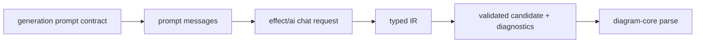

# diagram-generation

Model-facing generation helpers for Sketchi diagram candidates.



| Owns                                      | Does not own                  |
| ----------------------------------------- | ----------------------------- |
| provider prompt and request contracts     | eval scenarios and assertions |
| prompt message mapping                    | chat threads                  |
| gateway route for each upstream           | artifact persistence          |
| Effect client contract and runtime layers | UI streaming                  |
| candidate parsing and diagnostics         | final grading/revision policy |
| deterministic intent-plan enforcement     | artifact persistence          |

## Commands

```sh
pnpm nx test diagram-generation
pnpm nx typecheck diagram-generation
pnpm nx build diagram-generation
```

## Direction

`DiagramGenerationClient` is the Effect-native primary API. Workers compose the
Cloudflare AI Gateway binding (`CloudflareGatewayChatClientLive`) at their
runtime boundary. It runs on `effect/ai` through Google's OpenAI-compatible
endpoint; the binding authenticates the request and supplies the stored Google AI
Studio BYOK key, so no provider credential is read or sent. The public
Sketchi generate API and the eval harness are the only hosts that compose this
client. There is no client-side/CLI token adapter: the CLI reaches generation
through one unauthenticated HTTPS call to the public generate API. Pure prompt,
response, and candidate helpers stay independent of runtime wiring.

## Family routing

An untyped request carries every family's rules unless routing narrows it.
`withNarrowedFamilyRoute` reads the request's words first. A request that names
one family gets that family's typed prompt; one that names two or three gets a
prompt with only their rules.

When the words name no family and the host provides `DiagramFamilyNarrowing`,
Jev (TypeSafe's `jev-1.14.0`) ranks every kind of diagram for the request, then
re-checks the best three against what each draws and what it is not for. Its
answers never reach the generation model; code in `family-narrowing.ts` reads
them:

| Jev's answers                       | Prompt                              |
| ----------------------------------- | ----------------------------------- |
| one family settled                  | that family's typed prompt          |
| two or three families left          | only their rules                    |
| none, more than three, or unsettled | every family's rules                |
| an error or a timeout               | as without Jev, routed by its words |

Without Jev, a request that describes a process, a pipeline or an architecture
gets the flowchart prompt. Questions, option descriptions and thresholds live in
`family-questions.ts`. Each Jev request is its own
`diagramGeneration.familyNarrowing.round` span with the questions, answers,
model and usage, and the request's span records `family_route`,
`family_narrowing` and `family_shortlist`. Studio composes
`typeSafeFamilyNarrowingLayer` when its Worker has a `TYPESAFE_API_KEY` secret.
`pnpm eval:family-narrowing` measures the router over the tuning prompts and
`tools/family-narrowing-cases.json`, the same prompts with their family names
removed.
