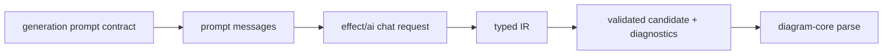

# diagram-generation

Model-facing generation helpers for Sketchi diagram candidates.



| Owns                                      | Does not own                  |
| ----------------------------------------- | ----------------------------- |
| provider prompt and request contracts     | eval scenarios and assertions |
| prompt message mapping                    | chat threads                  |
| gateway route for each upstream           | artifact persistence          |
| Effect client contract and runtime layers | UI streaming                  |
| candidate parsing and diagnostics         | final grading/revision policy |
| deterministic intent-plan enforcement     | artifact persistence          |

## Commands

```sh
pnpm nx test diagram-generation
pnpm nx typecheck diagram-generation
pnpm nx build diagram-generation
```

## Direction

`DiagramGenerationClient` is the Effect-native primary API. Workers compose the
Cloudflare AI Gateway binding (`CloudflareGatewayChatClientLive`) at their
runtime boundary. It runs on `effect/ai` through Google's OpenAI-compatible
endpoint; the binding authenticates the request and supplies the stored Google AI
Studio BYOK key, so no provider credential is read or sent. The public
Sketchi generate API is the only host that composes this client. There is no client-side/CLI token adapter: the CLI reaches generation
through one unauthenticated HTTPS call to the public generate API. Pure prompt,
response, and candidate helpers stay independent of runtime wiring.

## Family routing

An untyped request carries every family's rules unless routing narrows it.
`withNarrowedFamilyRoute` reads the request's words first: one named family gets
that family's typed prompt, two or three get only their rules. When the words
name no family and the host provides `DiagramFamilyNarrowing`, Jev
(`typesafe/jev-1.14.0` on Workers AI) picks the families in
`family-narrowing.ts`, with its questions and thresholds in
`family-questions.ts`. An error or timeout falls back to the words. Studio
composes `workersAiFamilyNarrowingLayer` over its `AI` binding, so no API key is
involved; `jev-workers-ai.ts` answers DecisionModel questions there. The route is internal: it shows only on spans
(`diagramGeneration.familyNarrowing.round`, and `family_route`,
`family_narrowing` and `family_shortlist` on the request's span), never in a
response. Frontierclimb's `sketchi-generate` catalog measures it.
