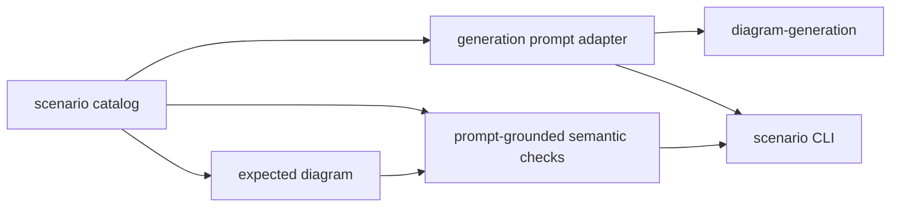

# diagram-scenarios

Maintained prompts, expected diagrams, and scenario evaluation for Sketchi generation work.



| Owns                              | Does not own                   |
| --------------------------------- | ------------------------------ |
| scenario catalog and prompts      | provider credentials           |
| expected diagram fixtures         | live app routing               |
| semantic output checks            | Excalidraw rendering internals |
| local command-provider CLI wiring | final product UX               |

## Commands

```sh
pnpm nx test diagram-scenarios
pnpm nx typecheck diagram-scenarios
pnpm nx build diagram-scenarios
pnpm nx scenario diagram-scenarios -- --scenario pharma-batch-disposition --fixture --out .memory/pharma-batch.excalidraw
```

## Families

`diagramScenarios` holds every maintained scenario, discriminated by
`diagramType`; the CLI (`--list`, `--all`, `--scenario`), the fixture client,
and the eval harness use it.

- Flowchart scenarios check prompt-grounded steps, node kinds, branches, bounded
  connections, and logos.
- Sequence scenarios check participants, required messages and their
  chronological order, calls answered by returns (activation bars), and that
  no return is stray.

Checks that measure the model (logos, sequence structure) score the model's own
diagram from before candidate enforcement, so a repair never hides a model
regression when that original diagram is available. Run one with
`pnpm nx scenario diagram-scenarios -- --scenario checkout-payment-sequence --fixture`.

### Flowchart matching

Each fixture node declares any-of label alternatives using words from its
scenario prompt. The catalog validates that grounding when loaded. A model
node must match an alternative **and that step's node kind**. An expected end
step also accepts a process whose sole outgoing edge leads directly to an end
node; no decision/start substitute, intermediate work, or additional continuation
is allowed. All canonical graph validation and exclusive ownership checks remain.
Case, punctuation, hyphens, and whitespace are normalized. Every content-word
lemma in an alternative must appear in a single label clause, in any order.
Unnegated qualifier segments may combine across parentheses, colons, and commas:
`Monitoring (low severity)` and `Monitoring: low-severity incident` both match
`monitoring low severity`. A segment containing any negator is a hard boundary;
its words cannot contribute to a positive alternative, nor can matching jump
across it. Semicolons and other sentence/action separators do not combine clauses.
Whole words prevent `ineligible` from satisfying `eligible`.

Action steps require action-bearing alternatives (`acknowledges`, not just
`responder`; `sends customer communications`, not just `communications`).
Named stages or destinations use their names when the prompt supplies no
action, rather than inventing a fixture-only verb. Decision alternatives
retain the prompt's criterion, such as `scope clear` or `payment succeeds`.

`flowchart-labels.ts` lists the finite lemma table used on both sides:
`comms` → `communications`, `rollback` → `roll back`, `retesting` → `retest`,
and explicit inflections such as `classifies` → `classify`, `refunded` → `refund`,
`verification` → `verify`, `uploaded` → `upload`, and `payment`/`paid` → `pay`.
Thus `Verify income` matches `income verification`, and `Expense paid` matches
`payment`. The explicit stopword set removes articles, auxiliaries, conjunctions,
and common prepositions, but retains criterion/condition words and negators.
Stopword-only alternatives never match. There is no suffix guessing, general
prefix, fuzzy, or semantic matcher; sequence and logo matching are unchanged.
Adjacent `not`, `no`, `never`, `without`, `cannot`, and explicit ignore/skip/omit
forms reject a match. Contracted negatives such as `isn't` normalize to `not`;
`fails to` and `unable to` also reject a positive action. The guard examines
preceding words for each required lemma in the same clause, extending over explicit auxiliary/adverb
forms such as `not yet been successfully`. Commas, colons, semicolons, arrows,
parentheses, slashes, spaced dashes, sentence punctuation, sentence line breaks,
and explicit conjunctions (`and`, `or`, `then`, `but`, `so`, `otherwise`) reset
that context.
Periods inside names such as `Next.js` are not sentence boundaries, and a
formatting wrap after `not` or its auxiliary/adverb chain retains negation.
Commas, colons, and semicolons always reset negation context. Thus
`Incident not resolved` fails, but `No fix: incident resolved` can pass.
When the prompt itself specifies a negative precondition followed by a
positive action, the catalog includes that complete phrase as an alternative.
Every flowchart prompt is audited for negative, missing/invalid, and fallback
conditions, with full-caption regressions for each affected step and its
incoming connections. Examples include
`Failed tests block release`, `No response removes the party from the list`,
`No violation restores content`, `Risk that is not acceptable rejects the
vendor`, and short fallback clauses such as `If not, monitor stock`.
Those conditions do not negate the action;
`Failed tests do not block release` still fails. These are explicit prompt
alternatives, not inferred causal or semantic matches. A negative operator is
exempt only when it immediately governs the same precondition word as in the
alternative, allowing auxiliary/adverb gaps. The `not` in `not ready` cannot
exempt the consequence in `Ready do not keep waiting`. Neither `Income not
verified` nor `Verify address; income not verified` matches `income verification`.

Each required connection must follow a directed path from a matching source to
a matching target through **at most two intermediate nodes**. Every intermediate
must match no expected step's label alternatives and node kind. An elaboration
such as a `Wait for link click` process does not stand in for the required
`Link clicked?` decision, which still needs its own correctly typed node.
This permits an explicit action followed by a check (`Build artifact → Run
security scan → Scan clean?`) or preparation plus a check, while preventing
arbitrary reachability from hiding skipped or reordered required steps.
Two intermediates cover those small elaborations; longer paths remain unverified.
Existing continuous same-step splits still work through exclusive ownership.
When a branch label is required, its any-of match must appear on the **first hop**
out of the source, not on a later edge. Contextual outcomes are finite, explicit
alternatives on that connection, validated against prompt words with the same
lemma table: `Acceptable`/`Unacceptable` for credit, `High`/`Low` for priority,
and `Matched`/`Not matched` for PO matching. They are not global yes/no synonyms.
Multiple model nodes may match one step, allowing separate resolved/review
end nodes per path. Every required step must have a distinct matching node,
and **all required edges must fit the same exclusive node ownership**. The
evaluator searches joint edge witnesses, trying the most constrained edge
first and memoizing failed ownership states. Each witness must lie on a
start-to-end path using only bounded required cross-step connections or continuous
same-step segments. This permits serial intermediate splits and separate
terminal copies, without stitching a step through an intervening different
step or moving draft before its decision. A combined node cannot stand in
for two steps, nor can disconnected/padded matches justify its wiring.
Maximum bipartite matching supplies failure diagnostics when no connected
assignment exists; successful edge checks use the connected ownership.
Optimistic reachability prunes impossible paths before choosing ownership,
and completion assigns only nodes that can lie on a start-to-end path.
Search visits at most 10,000 states. If that limit prevents verification,
failed connection messages report the limit rather than implying a proven
wiring defect; an independently verified fallback assignment can still pass.
Minimum node/edge counts remain lower bounds; extra nodes
do not fail them, and padding cannot replace a missing required step.
Required kinds, branches, connections, logo checks, and Excalidraw validation
remain gating checks.

Fixture labels remain in check IDs for stable diagnostics, but do not gate
label wording. For example, `node-label:Review diagram` accepts an end node
named `Review`, as the prompt requests. No exact-wording metric is emitted.

## CLI JSON contract

Build once, then invoke the CLI directly for subprocess use. The direct command
keeps Nx task output out of stdout:

```sh
pnpm nx build diagram-scenarios
node packages/diagram/scenarios/dist/cli.js --list
node packages/diagram/scenarios/dist/cli.js --scenario incident-escalation --input flowchart-execute.json
node packages/diagram/scenarios/dist/cli.js --scenario checkout-payment-sequence --input sequence-execute.json
```

`--list` prints a JSON array with `id`, `diagramType`, `title`, `description`,
`difficulty`, `tags`, and `prompt`. `prompt` is the exact `scenario.prompt` user
text, not the expanded generator prompt or expected diagram.

`--scenario <id> --input <file>` grades one saved JSON input, without network
calls. Both flowchart and sequence scenarios accept:

- Bare canonical diagram IR, including its `type`.
- A generation response envelope `{ title, intent, diagram }`.
- An MCP execute `structuredContent` payload
  `{ ok, result, logs, error?, artifactDelivery? }`.
- The payload's `result`, a bare build result
  `{ ok: true, status: "accepted", normalizedSpec, ... }`.
- A full MCP tool result `{ structuredContent: <execute payload>, ... }`.
- A failed MCP tool result `{ content: [{ type: "text", text: <error> }], isError: true }`.

For MCP inputs, the nested build must have `ok: true`, `status: "accepted"`,
and an object `normalizedSpec`. Execute success alone is insufficient. Failed
execution, an unaccepted build, or a missing spec produces `ok: false`, a
failing `mcp-build-accepted` check with a diagnostic message, and exit code 1.
Accepted builds add a passing `mcp-build-accepted` check and run the same
`evaluateScenarioDiagram` checks as diagram IR. Build acceptance does not
guarantee that the scenario passes.

The single-scenario stdout object retains `ok` and
`checks: [{ id, passed, message }]`, alongside its existing result metadata.
Exit code 0 means every gating check passed; 1 means evaluation failed; 2 means invalid
CLI usage. `--report-out <file>` saves the same JSON report.

MCP inputs grade the returned normalized diagram, including its logos and
sequence structure. This is not an exact stand-in for the model's original
spec: the MCP runtime can normalize slugs and drop unknown logos. Logo checks
therefore describe the retained normalized logos, not pre-normalization model
precision. The adapter does not add, move, or repair logos; use a generation
response envelope when pre-enforcement model-quality evidence is needed.

## Testing

Vitest covers label normalization, missing steps, wrong kinds/connections/
branches, deterministic fixture exports, and offline CLI replay of captured
MCP results. The `ci / required` job runs these Nx tests, typechecks, builds,
and repository lint/format gates. Capture replay is not a live MCP call;
these checks do not establish current deployed behavior.

## Usage

Generation packages, playground routes, and harness evals use these scenarios as
the stable product-quality substrate. Add new scenarios here when a diagram
failure should become repeatable before it grows into heavier eval tooling.
