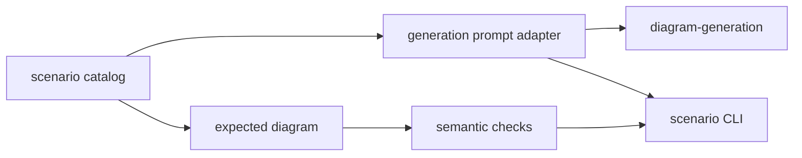

# diagram-scenarios

Maintained prompts, expected diagrams, and scenario evaluation for Sketchi generation work.



| Owns                              | Does not own                   |
| --------------------------------- | ------------------------------ |
| scenario catalog and prompts      | provider credentials           |
| expected diagram fixtures         | live app routing               |
| semantic output checks            | Excalidraw rendering internals |
| local command-provider CLI wiring | final product UX               |

## Commands

```sh
pnpm nx test diagram-scenarios
pnpm nx typecheck diagram-scenarios
pnpm nx build diagram-scenarios
pnpm nx scenario diagram-scenarios -- --scenario pharma-batch-disposition --fixture --out .memory/pharma-batch.excalidraw
```

## Families

`diagramScenarios` holds every maintained scenario, discriminated by
`diagramType`; the CLI (`--list`, `--all`, `--scenario`), the fixture client,
and the eval harness use it.

- Flowchart scenarios check nodes, branches, edges, and logos.
- Sequence scenarios check participants, required messages and their
  chronological order, calls answered by returns (activation bars), and that
  no return is stray.

Checks that measure the model (logos, sequence structure) score the model's own
diagram from before candidate enforcement, so a repair never hides a model
regression when that original diagram is available. Run one with
`pnpm nx scenario diagram-scenarios -- --scenario checkout-payment-sequence --fixture`.

## CLI JSON contract

Build once, then invoke the CLI directly for subprocess use. The direct command
keeps Nx task output out of stdout:

```sh
pnpm nx build diagram-scenarios
node packages/diagram/scenarios/dist/cli.js --list
node packages/diagram/scenarios/dist/cli.js --scenario incident-escalation --input flowchart-execute.json
node packages/diagram/scenarios/dist/cli.js --scenario checkout-payment-sequence --input sequence-execute.json
```

`--list` prints a JSON array with `id`, `diagramType`, `title`, `description`,
`difficulty`, `tags`, and `prompt`. `prompt` is the exact `scenario.prompt` user
text, not the expanded generator prompt or expected diagram.

`--scenario <id> --input <file>` grades one saved JSON input, without network
calls. Both flowchart and sequence scenarios accept:

- Bare canonical diagram IR, including its `type`.
- A generation response envelope `{ title, intent, diagram }`.
- An MCP execute `structuredContent` payload
  `{ ok, result, logs, error?, artifactDelivery? }`.
- The payload's `result`, a bare build result
  `{ ok: true, status: "accepted", normalizedSpec, ... }`.
- A full MCP tool result `{ structuredContent: <execute payload>, ... }`.
- A failed MCP tool result `{ content: [{ type: "text", text: <error> }], isError: true }`.

For MCP inputs, the nested build must have `ok: true`, `status: "accepted"`,
and an object `normalizedSpec`. Execute success alone is insufficient. Failed
execution, an unaccepted build, or a missing spec produces `ok: false`, a
failing `mcp-build-accepted` check with a diagnostic message, and exit code 1.
Accepted builds add a passing `mcp-build-accepted` check and run the same
`evaluateScenarioDiagram` checks as diagram IR. Build acceptance does not
guarantee that the scenario passes.

The single-scenario stdout object retains `ok` and
`checks: [{ id, passed, message }]`, alongside its existing result metadata.
Exit code 0 means every check passed; 1 means evaluation failed; 2 means invalid
CLI usage. `--report-out <file>` saves the same JSON report.

MCP inputs grade the returned normalized diagram, including its logos and
sequence structure. This is not an exact stand-in for the model's original
spec: the MCP runtime can normalize slugs and drop unknown logos. Logo checks
therefore describe the retained normalized logos, not pre-normalization model
precision. The adapter does not add, move, or repair logos; use a generation
response envelope when pre-enforcement model-quality evidence is needed.

## Usage

Generation packages, playground routes, and harness evals use these scenarios as
the stable product-quality substrate. Add new scenarios here when a diagram
failure should become repeatable before it grows into heavier eval tooling.
