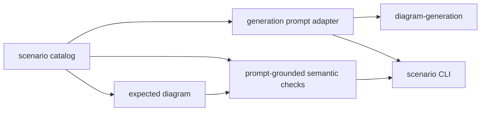

# diagram-scenarios

Maintained prompts, expected diagrams, and scenario evaluation for Sketchi generation work.



| Owns                              | Does not own                   |
| --------------------------------- | ------------------------------ |
| scenario catalog and prompts      | provider credentials           |
| expected diagram fixtures         | live app routing               |
| semantic output checks            | Excalidraw rendering internals |
| local command-provider CLI wiring | final product UX               |

## Commands

```sh
pnpm nx test diagram-scenarios
pnpm nx typecheck diagram-scenarios
pnpm nx build diagram-scenarios
pnpm nx scenario diagram-scenarios -- --scenario pharma-batch-disposition --fixture --out .memory/pharma-batch.excalidraw
```

## Families

`diagramScenarios` holds every maintained scenario, discriminated by
`diagramType`; the CLI (`--list`, `--all`, `--scenario`), the fixture client,
and the eval harness use it.

- Flowchart scenarios check prompt-grounded steps, node kinds, branches, bounded
  connections, and logos. Group scenarios also check that each stated group holds
  its steps and that steps the prompt keeps outside every group stay ungrouped.
  `outsideGroups` scopes an exclusion to a stated group, checking each step's
  full group ancestry. Kubernetes' browser, database and queue may share external
  wrappers, but cannot sit in the cluster or any descendant. AWS users may sit
  in an Internet wrapper, but not in us-east-1, its VPC or any nested subnet.
  Role/team groups accept either frames or swimlanes (`roleGroups` in the scenario
  definition); explicit zones and regions still require groups. A helper's
  purpose is not a performed step:
  `Resubmit report for review` does not own `Review report`, but a separately
  stated resubmit step must still sit in its stated group. Only the action word
  must occur outside a `for` purpose; object words may occur inside it, so
  `Enable flag for internal users` still names `enabled internally`.
  All nodes that really name a stated step are checked, not just one convenient
  edge witness.
  Swimlane scenarios check that each stated lane holds its steps, that lanes
  keep the stated order, and that each handoff crosses between its two lanes.
  Zone scenarios check that each stated zone holds its steps (directly or in a
  zone nested in it), sits inside the zone the prompt puts it in, and has a kind
  that reads as what the prompt calls it, and that each database, queue or
  document the prompt states draws as one.
- Sequence scenarios check participants, required messages and their
  chronological order, calls answered by returns (activation bars), and that
  no return is stray.
- Mindmap scenarios check the central topic, every stated topic under its
  stated parent, and no topic the prompt never states. Drawn topics are matched
  to stated ones top down, each taking the best unclaimed match under the topic
  its parent took. A layout check reads the drawn scene: no overlapping topics,
  crossing curves, or curve through a topic.
- State-machine scenarios check every stated state and the composite it sits
  in, the initial state, each composite's initial substate, and every stated
  transition between the right states with its event, guard and action in
  their own fields. A transition into or out of a composite must start or end
  at the composite itself. A named end matches a labeled final state or a state
  with a transition into a final.
- Gantt scenarios check every stated task with its dates, milestone, phase,
  progress and dependencies, and no invented dependency. Scene checks read the
  drawn bars back off the axis gridlines, require every label, date caption,
  phase header and dependency arrow, and fail any collision between text,
  marks, rules and arrows.
- ER scenarios check every stated entity, each of its fields with its type and
  its exact PK, FK, UK and nullable markers, and every stated relationship
  between the right entities through the right fields with the right
  cardinality at each end, in either direction. No entity or relationship the
  prompt does not state may appear, and the drawn scene must show every table,
  field, marker and crow's-foot end the diagram states.
- Class scenarios check every stated class and its kind, every attribute with
  its type, visibility and static marker, every method with its parameter and
  return types and its markers, and every stated relationship between the
  right classes, of the right kind and in the right direction (an association
  either way), with the multiplicities, roles and navigability it states. No
  class or relationship the prompt does not state may appear. The drawn scene
  must show every member, head, dash, multiplicity and role, each label clear
  of every box, line and other label.
- Org chart scenarios check every stated person by name with their title and
  department, the manager each reports to (none for the top), every stated
  assistant and dotted-line report, and department regions when the prompt
  asks. No person, assistant or dotted line the prompt does not state may
  appear. The drawn scene must show every card, name, title, reporting line,
  dotted line and region, with cards apart and lines orthogonal, through no
  card and never crossing.

Checks that measure the model (logos, sequence structure) score the model's own
diagram from before candidate enforcement, so a repair never hides a model
regression when that original diagram is available. Run one with
`pnpm nx scenario diagram-scenarios -- --scenario checkout-payment-sequence --fixture`.

### Flowchart matching

Each fixture node declares any-of label alternatives using words from its
scenario prompt. The catalog validates that grounding when loaded. A model
node must match an alternative **and that step's node kind**. An expected end
step also accepts a process whose sole outgoing edge leads directly to an end
node, or a process whose every outgoing edge loops back to work it came from
(`Request a receipt → Receipt attached?`): the prompt states the action, not
that nothing follows it. No decision/start substitute or intervening work is
allowed, and a stated loop drawn as a terminal end (`Send another reminder` as
an end) still fails. An expected start step also accepts a start node plus up
to two plain, single-input actions after it, matched on their combined labels
and owned by the last one, so `Question arrives → Vercel hosts the page →
Next.js page receives the question` is the stated `Next.js page on Vercel
receives the question`. A fixture `entry` lists the fixture nodes that draw
such a first event. All canonical graph validation and exclusive ownership
checks remain.

The `ai-app-stack-logos` scenario explicitly opts its cached-answer outcome into
`sharedEnds: { cached: "answer" }`. Only a matching branch from the stated cache
decision directly into the stated terminal answer node may stand for this
outcome. A bare `yes`/`hit` uses the decision's cache condition; longer captions
must name the cached-answer outcome without negation. Other decisions, wrong
branches, intermediate work, and other targets still fail. Matching splits this
edge into a distinct semantic outcome witness, inheriting the decision's lane
and group without padding drawn node/edge minimums. No other outcome is opted in.

`invoice-approval` opts only the unlabeled `director-approval -> schedule-payment`
connection into an equivalent `payment` outcome. The finite positive vocabulary
accepts payment/pay/paid with make, process, issue, release, send or schedule,
optionally naming the invoice or saying "after approval". Other content words
(including rejection, hold, pending, review or approval without "after") fail.
This vocabulary is not a global alias or a prompt-word alternative.

The payment node must be a terminal end, or a process whose single edge leads
directly to a terminal end that is not another stated outcome (such as rejection).
No intervening work or branches qualify. The threshold decision's payment
branch uses its original matching rules. Actual nodes retain lane/group and
share the outcome's ownership. Only newly accepted duplicate equivalents are
deducted from minimum node counts; existing canonical matches are unchanged.
No synthetic steps are added.

Case, punctuation, hyphens, and whitespace are normalized. Every content-word
lemma in an alternative must appear in a single label clause, in any order.
Unnegated qualifier segments may combine across parentheses, colons, and commas:
`Monitoring (low severity)` and `Monitoring: low-severity incident` both match
`monitoring low severity`. A segment containing any negator is a hard boundary;
its words cannot contribute to a positive alternative, nor can matching jump
across it. A subordinate clause (`after`, `because`, `if`, `once`, `when`)
starts its own segment, so `Roll back the feature after failed internal checks`
still matches `roll back`. `without` also starts its own (negated) segment, so
`Decline application without exception approval` matches `decline
application` and `Incident resolved without further impact` matches
`resolved`, while `Proceed without review` still fails `review`. A negator
before the action (`Do not roll back after failed checks`) still rejects it.
Semicolons and other sentence/action separators do not combine clauses.
Whole words prevent `ineligible` from satisfying `eligible`.

Action steps require action-bearing alternatives (`acknowledges`, not just
`responder`; `sends customer communications`, not just `communications`).
Named stages or destinations use their names when the prompt supplies no
action, rather than inventing a fixture-only verb. Decision alternatives
retain the prompt's criterion, such as `scope clear` or `payment succeeds`.
A process or end step also accepts the noun phrase left when an alternative's
leading action verb is dropped: `Routine appointment` for `schedules a routine
appointment`, `Nurse triage` for `perform nurse triage`. The verb must come
from a finite list in `flowchart-labels.ts`, at least two object words must
remain, and the label's content words must be exactly those object words.
A question, a lone noun (`Appointment`), a different verb (`Cancel routine
appointment`), extra words, a dropped named entity (`Answer` for `store the
answer in Redis`), and negation still fail. Starts, decisions, branches, and
edges never drop words this way.

Both sides reduce words to a shared inflection stem in three stages: a
plural or third-person `-s`/`-es`/`-ies`, then `-ed`/`-ied`/`-ing`, then a
final `ie` → `y` or silent `e`. A stage that would leave under two letters or
produce an operator word is skipped and stops the rest, so every form of a word
lands on the same stem. Thus `Does a known fix exist?` matches `known fix
exists`, `Identify a business need` matches `need identified`, `Nurse triages`
matches `nurse triage`, and `cookies`/`cookie`, `settings`/`setting` and
`use`/`uses`/`used`/`using` each share a stem. Operator words (stopwords,
negators, auxiliary gaps, conjunctions, subordinators, `yes`) keep their exact
form, and stemming never turns a content word into one. `flowchart-labels.ts` keeps a finite table for
what the stemmer cannot reach: derivations and irregular forms (`verification`
→ `verify`, `payment`/`paid` → `pay`, `sent` → `send`, `approval` →
`approve`), the compound `rollback` → `roll back`, `comms` → `communications`,
and inflected negators (`failed` → `fail`, `skipped` → `skip`). Thus `Verify
income` matches `income verification`, and `Expense paid` matches `payment`.
The explicit stopword set removes articles, auxiliaries, conjunctions, and
common prepositions, but retains criterion/condition words and negators.
Stopword-only alternatives never match. Every content word of an alternative,
including named entities such as `OpenAI` or `Redis`, must still appear: extra
modifiers are fine (`Roll back the unhealthy canary`), missing words are not
(`Call the model`, `Roll back the release`). Beyond the stemmer there is no
general prefix, fuzzy, synonym, or semantic matcher; sequence and logo
matching are unchanged.
Adjacent `not`, `no`, `never`, `without`, `cannot`, and explicit ignore/skip/omit
forms reject a match. Contracted negatives such as `isn't` normalize to `not`;
`fails to` and `unable to` also reject a positive action. The guard examines
preceding words for each required lemma in the same clause, extending over explicit auxiliary/adverb
forms such as `not yet been successfully`. Commas, colons, semicolons, arrows,
parentheses, slashes, spaced dashes, sentence punctuation, sentence line breaks,
and explicit conjunctions (`and`, `or`, `then`, `but`, `so`, `otherwise`) reset
that context.
Periods inside names such as `Next.js` are not sentence boundaries, and a
formatting wrap after `not` or its auxiliary/adverb chain retains negation.
Commas, colons, and semicolons always reset negation context. Thus
`Incident not resolved` fails, but `No fix: incident resolved` can pass.
When the prompt itself specifies a negative precondition followed by a
positive action, the catalog includes that complete phrase as an alternative.
Every flowchart prompt is audited for negative, missing/invalid, and fallback
conditions, with full-caption regressions for each affected step and its
incoming connections. Examples include
`Failed tests block release`, `No response removes the party from the list`,
`No violation restores content`, `Risk that is not acceptable rejects the
vendor`, and short fallback clauses such as `If not, monitor stock`.
Those conditions do not negate the action;
`Failed tests do not block release` still fails. These are explicit prompt
alternatives, not inferred causal or semantic matches. A negative operator is
exempt only when it immediately governs the same precondition word as in the
alternative, allowing auxiliary/adverb gaps. The `not` in `not ready` cannot
exempt the consequence in `Ready do not keep waiting`. Neither `Income not
verified` nor `Verify address; income not verified` matches `income verification`.

Each required connection must follow a directed path from a matching source to
a matching target through **at most two intermediate nodes**. Every intermediate
must match no expected step's label alternatives and node kind. An elaboration
such as a `Wait for link click` process does not stand in for the required
`Link clicked?` decision, which still needs its own correctly typed node.
This permits an explicit action followed by a check (`Build artifact → Run
security scan → Scan clean?`) or preparation plus a check, while preventing
arbitrary reachability from hiding skipped or reordered required steps.
Two intermediates cover those small elaborations; longer paths remain unverified.
Existing continuous same-step splits still work through exclusive ownership.
When a branch label is required, its any-of match must appear on the **first hop**
out of the source, not on a later edge. Contextual outcomes are finite, explicit
alternatives on that connection, validated against prompt words with the same
lemma table: `Acceptable`/`Unacceptable` for credit, `High`/`Low` for priority,
and `Matched`/`Not matched` for PO matching. They are not global yes/no synonyms.
A required `yes`/`no` branch also accepts a restatement of its decision's
criterion (the fixture decision label): every content word must come from the
criterion, and the caption must carry the outcome, either the criterion's
predicate (its last content word) or, for `no`, `fail`. A subject alone
(`Canary`, `Scan`) states no outcome. A `no` restatement has exactly one
negation (a negator or the `un`/`in` prefixed predicate), a `yes` restatement
has none, and double negations (`Not failed`, `Not unhealthy`) are rejected. For `Canary healthy?`,
`Healthy` answers yes and `Not healthy`, `Unhealthy` answer no; for `Tests
pass?`, `Pass` answers yes and `Fail` answers no. `Healthy` on the rollback
edge still fails.

A **dimension question** answered by its branch values is the same decision:
`Risk level?` with `High risk`/`Low risk` (or `High`/`Low`) matches `Risk
high?`. The question must share a criterion word with an alternative, its label
plus one outgoing branch label must match the alternative, and its own label
must not already match any required step (a check drawn as its decision is
handled below). On a dimension question,
the branch that completes the criterion answers yes and any other value
answers no, so `High risk → Reset password` still fails.

A **value question** asks about one of a decision's stated values: on `Cache
hit?`, `Yes` answers the `hit` branch and `No` answers the only other value,
`miss`. It applies only to two-value decisions.

A **decision asked by its opposite condition** is the same decision with yes
and no swapped. It applies only to yes/no decisions the prompt states through
their branches, opposite condition first, never as a question: `If the receipt
is missing` lets `Receipt missing?` stand for `Receipt attached?`, so its `Yes`
answers the `no` branch to `Request receipt`. The scenario lists those
prompt-grounded alternatives in `inverse`. Stated outcomes keep their meaning
(`Attached` still answers yes), and unswapped answers fail. A decision the
prompt asks (`decide whether the exception is resolved`) accepts no opposite
form.

A **branch target qualified by its decision** carries its qualifier on the
branch: `Severity? → Monitoring` on the `Low` branch is `Monitoring low
severity`. The target and the branch must each supply a criterion word, the
target's own label must name no step, and the wrong branch (`Medium`) fails.

A **check drawn as its decision** keeps both steps when its branches state
exactly the next decision's outcomes: `Check supplier availability` with
`Available`/`Unavailable` is split into the check and `Supplier available?`
before matching, and node/edge minimums count both. Bare `Yes`/`No`, or
outcomes of a different decision, still fail both steps.
Multiple model nodes may match one step, allowing separate resolved/review
end nodes per path. Every required step must have a distinct matching node,
and **all required edges must fit the same exclusive node ownership**. The
evaluator searches joint edge witnesses, trying the most constrained edge
first and memoizing failed ownership states. Each witness must lie on a
start-to-end path using only bounded required cross-step connections or continuous
same-step segments. This permits serial intermediate splits and separate
terminal copies, without stitching a step through an intervening different
step or moving draft before its decision. A combined node cannot stand in
for two steps, nor can disconnected/padded matches justify its wiring.
Maximum bipartite matching supplies failure diagnostics when no connected
assignment exists; successful edge checks use the connected ownership.
Optimistic reachability prunes impossible paths before choosing ownership,
and completion assigns only nodes that can lie on a start-to-end path.
Search visits at most 10,000 states. If that limit prevents verification,
failed connection messages report the limit rather than implying a proven
wiring defect; an independently verified fallback assignment can still pass.
Minimum node/edge counts remain lower bounds; extra nodes
do not fail them, and padding cannot replace a missing required step.
Required kinds, branches, connections, logo checks, and Excalidraw validation
remain gating checks.

Fixture labels remain in check IDs for stable diagnostics, but do not gate
label wording. For example, `node-label:Review diagram` accepts an end node
named `Review`, as the prompt requests. No exact-wording metric is emitted.

## CLI JSON contract

Build once, then invoke the CLI directly for subprocess use. The direct command
keeps Nx task output out of stdout:

```sh
pnpm nx build diagram-scenarios
node packages/diagram/scenarios/dist/cli.js --list
node packages/diagram/scenarios/dist/cli.js --scenario incident-escalation --input flowchart-execute.json
node packages/diagram/scenarios/dist/cli.js --scenario checkout-payment-sequence --input sequence-execute.json
```

`--list` prints a JSON array with `id`, `diagramType`, `title`, `description`,
`difficulty`, `tags`, and `prompt`. `prompt` is the exact `scenario.prompt` user
text, not the expanded generator prompt or expected diagram.

`--scenario <id> --input <file>` grades one saved JSON input, without network
calls. Both flowchart and sequence scenarios accept:

- Bare canonical diagram IR, including its `type`.
- A generation response envelope `{ title, intent, diagram }`.
- An MCP execute `structuredContent` payload
  `{ ok, result, logs, error?, artifactDelivery? }`.
- The payload's `result`, a bare build result
  `{ ok: true, status: "accepted", normalizedSpec, ... }`.
- A full MCP tool result `{ structuredContent: <execute payload>, ... }`.
- A failed MCP tool result `{ content: [{ type: "text", text: <error> }], isError: true }`.

For MCP inputs, the nested build must have `ok: true`, `status: "accepted"`,
and an object `normalizedSpec`. Execute success alone is insufficient. Failed
execution, an unaccepted build, or a missing spec produces `ok: false`, a
failing `mcp-build-accepted` check with a diagnostic message, and exit code 1.
Accepted builds add a passing `mcp-build-accepted` check and run the same
`evaluateScenarioDiagram` checks as diagram IR. Build acceptance does not
guarantee that the scenario passes.

The single-scenario stdout object retains `ok` and
`checks: [{ id, passed, message }]`, alongside its existing result metadata.
Exit code 0 means every gating check passed; 1 means evaluation failed; 2 means invalid
CLI usage. `--report-out <file>` saves the same JSON report.

MCP inputs grade the returned normalized diagram, including its logos and
sequence structure. This is not an exact stand-in for the model's original
spec: the MCP runtime can normalize slugs and drop unknown logos. Logo checks
therefore describe the retained normalized logos, not pre-normalization model
precision. The adapter does not add, move, or repair logos; use a generation
response envelope when pre-enforcement model-quality evidence is needed.

## Testing

Vitest covers label normalization, missing steps, wrong kinds/connections/
branches, deterministic fixture exports, and offline CLI replay of captured
MCP results. The `ci / required` job runs these Nx tests, typechecks, builds,
and repository lint/format gates. Capture replay is not a live MCP call;
these checks do not establish current deployed behavior.

## Usage

Generation packages, playground routes, and harness evals use these scenarios as
the stable product-quality substrate. Add new scenarios here when a diagram
failure should become repeatable before it grows into heavier eval tooling.
