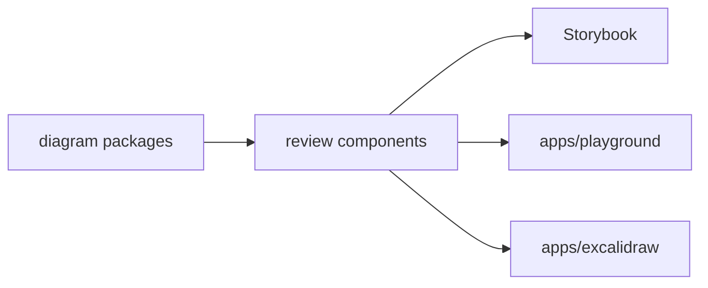

# diagram-ui

Reusable React components and Storybook states for Sketchi diagram review surfaces.



| Owns                                  | Does not own                   |
| ------------------------------------- | ------------------------------ |
| reusable diagram review components    | app routes or navigation       |
| Excalidraw canvas wrappers for review | Worker APIs or persistence     |
| shared component CSS and Storybook    | model calls or Code Mode tools |
|                                       | production domain deployment   |

## Commands

```sh
pnpm nx test diagram-ui
pnpm nx typecheck diagram-ui
pnpm nx build diagram-ui
pnpm nx storybook diagram-ui
pnpm nx build-storybook diagram-ui
```

## Usage

Apps compose this package when they need a diagram preview or an Excalidraw
canvas. Keep reusable state and component
coverage here; app-specific routing and service calls stay inside `apps/*`.

Storybook, Chromatic and the Storybook MCP endpoint are described in
[docs/storybook-chromatic.md](../../../docs/storybook-chromatic.md).
