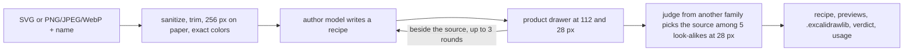

# icon-draw

Draws a logo as a hand-drawn Sketchi icon: an SVG or image and a name in, a
checked recipe (the `IconRecipe` format in `@sketchi/diagram-core`) out, with
PNG previews, an Excalidraw library and a blind judge's verdict. Studio serves
it as `POST /api/v1/icons/draw`.



| Owns                                                       | Does not own                                    |
| ---------------------------------------------------------- | ----------------------------------------------- |
| request checks and raster header sizes                     | SVG sanitizing and pixel features (icon-catalog) |
| the author prompt, reply schema and recipe normalization   | the recipe format and drawer (diagram packages)  |
| the round loop, the judge lineup and its one revision      | decoding and exporting images (the host)        |
| gateway calls for the author and the judge                 | HTTP, rate limits, publishing                   |

## How a draw runs

1. **Prepare.** An SVG is sanitized (no scripts, external references or metadata)
   and its exact paint colors read; a raster is checked from its header (type,
   1-4096 px, at most 4 MB). The host draws the logo on white paper, trims it to
   its ink and squares it at 256 px, quantizing a raster to its palette. Nothing
   is traced or vectorized.
2. **Author.** One vision model call per round writes a recipe as structured
   JSON. The fixed instructions and three catalog recipes as examples are
   cached by the provider. The recipe is normalized (rounding, near-miss source
   colors, black and white the source does not use as ink and paper) and
   checked; a recipe the checker rejects gets one repair turn.
3. **Review.** Each drawable recipe is drawn by the product drawer and exported
   at 112 px and 28 px beside the source. The author accepts it or revises, for
   at most three author calls in all.
4. **Judge.** A model from another family sees the 28 px drawing and five logos:
   the source and the four catalog marks it most resembles in color, layout and
   proportion (spares ranked after them replace any that fail to load or draw;
   without four, the judge does not run and the verdict says why). When it picks
   a look-alike and a round remains, the author sees the two side by side and
   revises once; the revision is kept only if the judge then picks the source.
   An unrecognized icon still comes back, marked.

A draw stays within 85 seconds. Every step (imaging, each model call and its
retries) stops at the deadline, author rounds and renders keep 15 seconds free
for the judge, and a round that would not fit is not started. A draw that runs
out of time with a drawing returns it; one without a drawing fails as a timeout.

## Services

- `IconImaging`: decode, measure and draw logos; export Excalidraw scenes. Studio
  runs it on Browser Rendering's warm export-harness pages.
- `IconDrawModels`: author and judge calls. `IconDrawModelsGateway` makes them
  through the Cloudflare AI Gateway binding with its stored provider keys.
- `IconCatalogSvgs`: catalog marks for the judge's lineup.

## Commands

```sh
pnpm nx test icon-draw
pnpm nx typecheck icon-draw
pnpm nx build icon-draw
```
