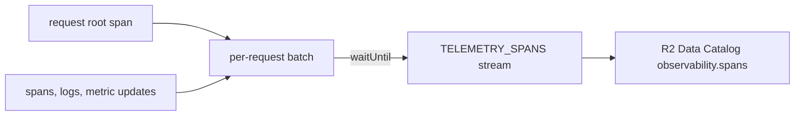

# observability

Workers-compatible Effect telemetry for Sketchi: every finished span, with its
full content, as a row for the spans Pipeline stream.



| Owns                                                 | Does not own                          |
| ---------------------------------------------------- | ------------------------------------- |
| the tracer, logger and metric exporter               | what each span records (its callers)  |
| span rows, their splitting, and per-request batches  | the Pipeline, sink and catalog        |
| request correlation: ray, run, attempt and other IDs | DuckDB views (`scripts/telemetry`)    |
| the stream schema, `spans.schema.json`               | AI Gateway request logging            |

`withTelemetryExport` makes the current span a request's root; the request's
spans are sent when it ends. `withSpanContent` and `SpanContent` name the content
a span records. The layer performs no module-scope I/O and starts no timers.
`makeTelemetryTestSink` receives every span as it finishes, for tests.

## Commands

```sh
pnpm nx test observability
pnpm nx typecheck observability
pnpm nx build observability
```
