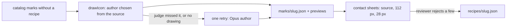

# icon-batch

Draws the icon catalog by hand: every catalog mark without a recipe goes
through the draw service's engine (`@sketchi/icon-draw`) in Node, and the
marks its judge recognizes become catalog recipes after a review of the
sheets.



| Owns                                                   | Does not own                                     |
| ------------------------------------------------------ | ------------------------------------------------ |
| choosing marks, concurrency, the spend stop, resuming  | the author, judge, prompts and limits (icon-draw) |
| imaging in Node: resvg for logos, Excalidraw's export  | the recipe format and drawer (diagram packages)   |
| the ledger, review sheets and promotion into `recipes/` | the public endpoint and its limits (Studio)       |

## How it differs from the endpoint

- **Gateway.** Calls go straight to Sketchi's AI Gateway with
  `CF_AIG_TOKEN`, through the same `IconDrawModelsGateway` the Worker uses, so
  the public endpoint's per-client and daily limits do not apply. Each call is
  tagged with `sketchiTraceId = icon-batch-<run>-<slug>-<attempt>`, and each
  attempt's cost is read back from the gateway's logs. The batch never
  retries a model POST; it only retries cost-log GETs.
- **Imaging.** Studio's harness page draws logos on a browser canvas; here
  resvg draws them (as it did for the catalog's look-alike features) and
  Excalidraw's own SVG export, rasterized by resvg, renders the recipes, with
  the CLI's headless DOM.
- **Wordmarks are not drawn.** The batch draws the catalog's node logos.
  Diagrams never put a `-text` wordmark in a node, a recipe's text is a short
  word, and 286 of the 298 wordmarks have a compact mark that is drawn.

## A run

```sh
export CF_AIG_TOKEN="$(infisical secrets get CF_AIG_TOKEN --projectId bb3fe729-e290-4740-84d4-304752f0d719 --env prod --path / --plain --silent)"
pnpm nx draw icon-batch -- draw --run catalog              # every mark without a recipe
pnpm nx draw icon-batch -- draw --run trial --sample 30    # a spread across collections
pnpm nx draw icon-batch -- sheets --run catalog
pnpm nx draw icon-batch -- summary --run catalog
pnpm nx draw icon-batch -- promote --run catalog --reject rejected.txt
pnpm nx draw icon-batch -- recipe-sheets --collection palantir --theme dark
```

- `draw` leaves the author to the source, as the draw service does when a
  request names none: Opus 5.5 for a detailed mark (40 or more curve segments),
  Sonnet 5.5 otherwise. `--author` names one model for every first draw.
- `draw` runs 4 draws at a time (`--concurrency`) and starts none that could
  take the run's spend past `--cap` (default $60). Each draw in flight holds
  the most it can cost: every author call the engine allows at its output
  limit, about $0.46 on Sonnet and $0.85 on Opus (a draw whose author the
  source will choose holds Opus's), where a typical draw costs $0.02. A draw
  that does not fit waits for in-flight attempts to checkpoint. Use one
  `draw` process per run. Before dispatch, the batch atomically records the
  attempt's ceiling in `.memory/icon-batch/<run>/marks/<slug>.json`. The
  completed attempt replaces that reservation in the same record.
  An unpriced draw with complete usage counts at its token estimate. An
  unpriced draw that dispatched a POST without complete usage counts at its
  ceiling, even if no log ID came back. A failure before dispatch costs zero.
- A write failure stops new draws. Admitted draws finish and the command
  reports the full accounted spend before it exits with an error. A preview
  failure does not discard the recipe or its charge. If a result could not
  be saved or the process died after reserving it, the next run counts the
  unresolved reservation at its ceiling and skips that mark, even if the
  cap has room. `summary` includes unresolved reservations in its spend.
  Repair the store and replace the mark record with the recovery JSON from
  stderr if available. Otherwise check the gateway trace for that mark and
  attempt (`attempts.length`); leave the reservation in place if the charge
  or dispatch is uncertain. Do not delete it to retry a possibly paid draw.
- `--notes notes.json` (`{ "slug": "what the last drawing lost" }`) hands
  the author a reviewer's note on a mark a review rejected, for a redraw.
  Notes are limited to 1,024 UTF-8 bytes each and increase the reservation
  for every author round that can read them.
- A mark the judge does not pick out of its look-alikes, or one that ends
  without a drawing, can get one separately budgeted draw with `--retry`
  (Opus 5.5). If that misses too, it stays out and the summary lists it.
- `sheets` writes `sheets/recognized-NN.png` and `sheets/review-NN.png`: 32
  marks each, the source beside the drawing at 112 and 28 px, with the verdict,
  author, rounds, parts and cost.
- `recipe-sheets` lays committed recipes out the same way, for a collection
  (`--collection`) or named marks (`--slugs`), on light paper or in
  Excalidraw's dark theme (`--theme dark`), under
  `.memory/icon-batch/recipe-sheets/`.
- `summary` writes `ledger.csv` (one row per mark) and `summary.md` (totals,
  per-mark cost, time, tokens, rounds and parts, and the marks staying out).
- `promote` writes each recognized mark's recipe to
  `packages/icons/catalog/recipes/`, except the slugs in `--reject` and any
  that already has one (`--replace` replaces it, for a run that redraws marks
  whose source or drawing changed), and lists any whose word would clip past the 24-unit
  grid or run over the pen of the shape that frames it. The draw engine already draws a monochrome mark's own black and white
  in `ink` and `paper`, so the drawing follows the theme where the mark's SVG
  inverts. Format the files with `pnpm format` before committing.

A recipe changes diagrams: a node naming that logo draws the recipe by hand
unless the diagram asks for exact marks (`logos: "exact"`). That is why the
sheets are reviewed before promotion.

## Commands

```sh
pnpm nx test icon-batch
pnpm nx typecheck icon-batch
```
