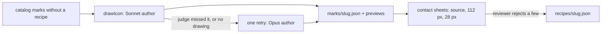

# icon-batch

Draws the icon catalog by hand: every catalog mark without a recipe goes
through the draw service's engine (`@sketchi/icon-draw`) in Node, and the
marks its judge recognizes become catalog recipes after a review of the
sheets.



| Owns                                                   | Does not own                                     |
| ------------------------------------------------------ | ------------------------------------------------ |
| choosing marks, concurrency, the spend stop, resuming  | the author, judge, prompts and limits (icon-draw) |
| imaging in Node: resvg for logos, Excalidraw's export  | the recipe format and drawer (diagram packages)   |
| the ledger, review sheets and promotion into `recipes/` | the public endpoint and its limits (Studio)       |

## How it differs from the endpoint

- **Gateway.** Calls go straight to Sketchi's AI Gateway with
  `CF_AIG_TOKEN`, through the same `IconDrawModelsGateway` the Worker uses, so
  the public endpoint's per-client and daily limits do not apply. Each call is
  tagged with `sketchiTraceId = icon-batch-<run>-<slug>-<attempt>`, and each
  attempt's cost is read back from the gateway's logs.
- **Imaging.** Studio's harness page draws logos on a browser canvas; here
  resvg draws them (as it did for the catalog's look-alike features) and
  Excalidraw's own SVG export, rasterized by resvg, renders the recipes, with
  the CLI's headless DOM.
- **Wordmarks are not drawn.** The batch draws the catalog's node logos.
  Diagrams never put a `-text` wordmark in a node, a recipe's text is a short
  word, and 286 of the 298 wordmarks have a compact mark that is drawn.

## A run

```sh
export CF_AIG_TOKEN="$(infisical secrets get CF_AIG_TOKEN --projectId bb3fe729-e290-4740-84d4-304752f0d719 --env prod --path / --plain --silent)"
pnpm nx draw icon-batch -- draw --run catalog              # every mark without a recipe
pnpm nx draw icon-batch -- draw --run trial --sample 30    # a spread across collections
pnpm nx draw icon-batch -- sheets --run catalog
pnpm nx draw icon-batch -- summary --run catalog
pnpm nx draw icon-batch -- promote --run catalog --reject rejected.txt
```

- `draw` runs 4 draws at a time (`--concurrency`) and starts none that could
  take the run's spend past `--cap` (default $60), counting a reserve for each
  draw in flight. Every attempt is written to
  `.memory/icon-batch/<run>/marks/<slug>.json` as it finishes; running again
  resumes the marks that are not settled.
- A mark the judge does not pick out of its look-alikes, or one that ends
  without a drawing, gets one retry with `--retry` (Opus 5.5). If that misses
  too, it stays out and the summary lists it.
- `sheets` writes `sheets/recognized-NN.png` and `sheets/review-NN.png`: 32
  marks each, the source beside the drawing at 112 and 28 px, with the verdict,
  author, rounds, parts and cost.
- `summary` writes `ledger.csv` (one row per mark) and `summary.md` (totals,
  per-mark cost, time, tokens, rounds and parts, and the marks staying out).
- `promote` writes each recognized mark's recipe to
  `packages/icons/catalog/recipes/`, except the slugs in `--reject` and any
  that already has one. Format the files with `pnpm format` before committing.

A recipe changes diagrams: a node naming that logo draws the recipe by hand
unless the diagram asks for exact marks (`logos: "exact"`). That is why the
sheets are reviewed before promotion.

## Commands

```sh
pnpm nx test icon-batch
pnpm nx typecheck icon-batch
```
